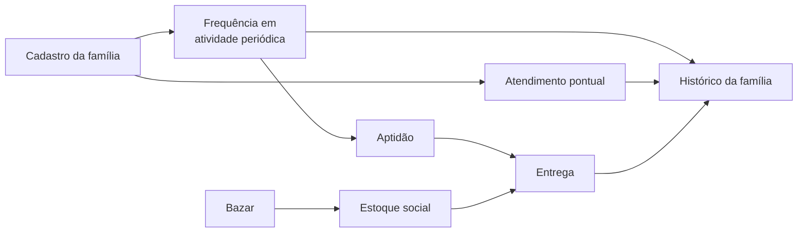
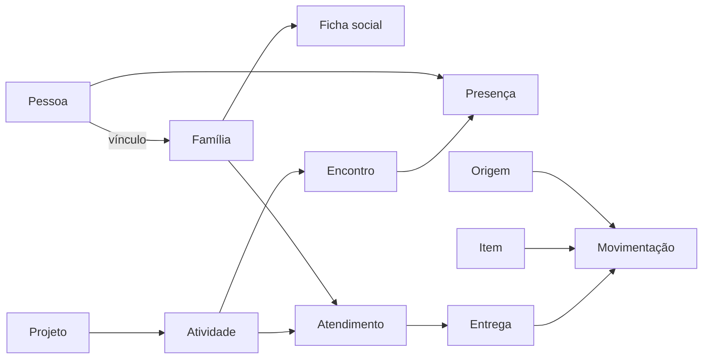
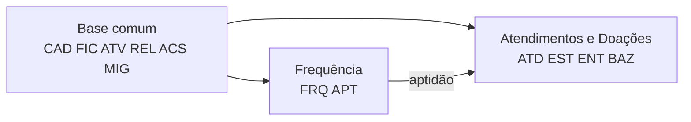

# Especificação de Requisitos de Software — ERP Social Luz da Esperança

Documento original: 24/09/2026 · @Ruan Pedro. Revisão técnica: 21/10/2026.

## Controle do documento

Esta é a versão 1.1 da Especificação de Requisitos de Software (ERS) do ERP Social, organizada segundo a estrutura da IEEE Std 830-1998. Ela deriva do PRD 1.1, incluindo sua atualização de 07/10/2026, e incorpora os controles operacionais já detalhados no planejamento de 21/10/2026. Esta revisão parte do relato de problemas no protótipo e corrige omissões de validação e integridade identificadas nos documentos. Políticas institucionais sem decisão continuam identificadas como LACUNA; validações técnicas necessárias ao comportamento especificado são obrigatórias e não aguardam uma nova política de negócio.

| Campo | Valor |
| --- | --- |
| Versão | 1.1 |
| Padrão | IEEE Std 830-1998, Recommended Practice for Software Requirements Specifications |
| Base de negócio | PRD do ERP Social Luz da Esperança, v1.1 (18/09/2026) |
| Escopo | ERP inteiro; cada requisito indica a frente que o implementa |
| Situação | Revisada para desenvolvimento e verificação; decisões institucionais pendentes continuam explícitas |

### Histórico de revisões

| Versão | Data | Alteração |
| --- | --- | --- |
| 1.0 | 24/09/2026 | Primeira versão, derivada do PRD 1.1, da transcrição, da ficha, da pesquisa de sistemas e da bibliografia. |
| 1.1 | 21/10/2026 | Revisão integral após avaliação do protótipo: CPF obrigatório, válido e único, validações comuns, histórico temporal, frequência, concorrência, estoque por lote, estornos, autorização, importação e cenários de regressão. Conciliação da retirada da central de duplicidades e das regras ainda abertas de nascimento, titularidade e associação entre institutos e projetos, sem presumir aprovação de políticas institucionais. |

### Convenções

| Marcação | Significado |
| --- | --- |
| RF-XXX-nn | Requisito funcional; XXX é o módulo. Ex.: RF-FRQ-02 é o item 2 de Frequência. |
| RNF-XXX-nn | Requisito não funcional: DES desempenho, CON confiabilidade, DIS disponibilidade, SEG segurança, MAN manutenibilidade, USA usabilidade. |
| IU-nn / INT-nn | Requisito de interface de usuário / de interface com outro sistema. |
| RES-nn | Restrição de projeto. |
| RN-nn | Regra de negócio. RN-01 a RN-17 mantêm a numeração do PRD. |
| AC-nn | Critério de aceite. AC-01 a AC-13 mantêm a numeração do PRD. |
| **LAC-nn** | **LACUNA**: informação que as fontes não definem e que a instituição precisa decidir. Todo requisito afetado cita a lacuna. |
| Origem C | Confirmado na transcrição, na ficha ou nos esclarecimentos da equipe, com a fonte indicada. |
| Origem P | Política ou comportamento de produto proposto pelo PRD ou pela ERS; sua aprovação institucional não é presumida. |
| Origem T | Detalhamento técnico de integridade e validação desta revisão, rastreado a requisitos existentes e ao planejamento. É obrigatório ao implementar a função; não fixa frequência mínima, critérios de distribuição nem autorização de dados sensíveis. |
| VAL-nn / OP-nn | Validação comum / contrato de operação da seção 3.4, aplicável a todos os módulos citados. |
| Essencial | Necessário ao ciclo mínimo de assistência (escopo mínimo do PRD). |
| Desejável | Evolução; pode vir depois sem impedir o núcleo. |
| Frente BC / FRQ / AD | Base comum / Frequência / Atendimentos e Doações, conforme a divisão descrita pelo professor \[F1, §18\]. |

Nas citações da transcrição, "F1, §n" é o n-ésimo parágrafo não vazio do arquivo, como no PRD.

## 1 Introdução

### 1.1 Propósito

Esta ERS define o que o ERP Social deve fazer, com que qualidade e sob quais restrições. Ela transforma o PRD 1.1 em requisitos verificáveis, sem decidir no lugar da instituição o que ainda está em aberto.

Os leitores são o professor responsável, as duas equipes que vão construir o ERP e os representantes da instituição que validam as regras. O documento serve de base para projeto, testes e aceite.

### 1.2 Escopo

O ERP Social registra a assistência prestada pelo Luz da Esperança: pessoas e famílias, situação social, projetos, atividades, frequência, atendimentos pontuais, estoque social e entregas de itens. Ele recebe itens transferidos do Bazar e substituirá o Bússola Social, sistema pago usado hoje \[F6\].

O resultado esperado é que a equipe consiga reconstruir a assistência a uma família, justificar uma entrega com evidências e conferir o destino de cada item.

| Dentro do escopo | Fora do escopo |
| --- | --- |
| Cadastro de pessoas, famílias e vínculos | Captação e doações financeiras, que ficam no CRM \[F1, §§7–12\] |
| Ficha social da família | Vendas, caixa, financeiro e estoque comercial, que ficam no Bazar \[F1, §13\] |
| Projetos, atividades, frequência e aptidão | Gestão da Escola Espírita \[F1, §1\] |
| Atendimentos pontuais, incluindo visita domiciliar | Prontuário clínico, diagnóstico e prescrição |
| Estoque social e entregas às famílias | Gestão de voluntários, divulgação e recursos humanos |
| Recebimento de itens vindos do Bazar | Contabilidade, obrigações fiscais e pagamentos |
| Consultas, relatórios, perfis de acesso e auditoria | Envio de itens do estoque social para o Bazar, não confirmado (LAC-07) |
| Migração dos dados do Bússola Social |  |

### 1.3 Definições, acrônimos e abreviações

| Termo | Definição |
| --- | --- |
| Pessoa assistida | Quem participa de uma atividade ou é beneficiado, direta ou indiretamente. Sempre está ligada a uma família \[F1, §2\]. Um operador não vira assistido por usar o sistema. |
| Família | Núcleo de referência da assistência, com número próprio, como na ficha \[F5\]. |
| Titular | Referência familiar proposta a partir do campo "Beneficiário(a)" da ficha \[F5\]. Obrigatoriedade, quantidade, critérios de designação e substituição dependem de LAC-02; a ficha não confirma essas regras para o sistema. |
| Projeto | Agrupamento de atividades \[F1, §5\]. A relação com institutos, sua obrigatoriedade e cardinalidade dependem de LAC-04, conforme DEC-04 do PRD. |
| Atividade periódica | Atividade com encontros recorrentes e controle de frequência, como Sementinha de Luz, Mocidade, alfabetização e bordado \[F1, §3\]. |
| Atendimento pontual | Atividade registrada por realização, sem chamada, como doação de itens, atendimento médico, psicológico e fisioterapia \[F1, §3\]. |
| Encontro | Cada ocorrência de uma atividade periódica, na qual se faz a chamada. |
| Presença | Registro de que a pessoa esteve em um encontro. Inscrição ou cadastro não é presença. |
| Aptidão | Condição de a família poder ser considerada para receber doações: pelo menos um membro frequentando uma atividade \[F1, §2\]. Não garante entrega. |
| Compatibilidade | Adequação de um item aos membros da família, como um calçado nº 39 \[F1, §4\]. |
| Prioridade | Ordem de atendimento entre famílias aptas. Exige critério próprio (LAC-03). |
| Entrega | Saída efetiva de itens do estoque social para uma família. Também conta como atendimento pontual. |
| Estoque social | Itens destinados à distribuição assistencial, separados do estoque do Bazar. |
| Transferência do Bazar | Passagem de itens do estoque comercial para o social \[F1, §14\]. Não é nova arrecadação. |
| Ficha social | Situação socioeconômica da família, baseada na Ficha de Cadastro de Famílias 2025 \[F5\]. |
| Operador | Pessoa da instituição que usa o sistema. |
| LACUNA | Política ou dado operacional que depende de decisão da instituição; não inclui validar CPF, evitar saldo negativo ou impedir duplicação de uma operação. |
| Não informada | Marcação ainda não efetuada; difere de ausência explícita em uma chamada. |
| Lote de estoque | Quantidade identificada por recebimento, item, unidade, tamanho, condição e validade aplicável. |
| Saldo físico controlado | Quantidade aceita e incorporada ao estoque, ainda não saída por movimento; pode incluir itens que depois ficaram vencidos ou impróprios. Material ainda em triagem é conferido separadamente e não integra esse saldo. |
| Saldo disponível | Parcela do saldo físico controlado em condição de uso e válida para a data da entrega. |
| Confirmação de operação | Pedido identificado para concluir um fato; reenvio do mesmo pedido não cria uma segunda ocorrência. |
| Conflito de edição | Tentativa de gravar sobre uma versão já alterada ou de reutilizar uma confirmação com dados diferentes; exige conferência explícita. |
| ACS | Agente Comunitário de Saúde, campo da ficha. |
| CRM | Sistema de relacionamento com doadores financeiros, outro produto do projeto. |
| ERS | Especificação de Requisitos de Software. |
| LGPD | Lei Geral de Proteção de Dados Pessoais, Lei nº 13.709/2018. |
| LOAS | Lei Orgânica da Assistência Social, Lei nº 8.742/1993. A transcrição diz "Lei Ordinária"; o nome correto é Orgânica. |
| ECA | Estatuto da Criança e do Adolescente, Lei nº 8.069/1990. |
| NOB/SUAS | Norma Operacional Básica do Sistema Único de Assistência Social, Resolução CNAS nº 33/2012. |

### 1.4 Referências

| Ref. | Documento | Uso nesta ERS |
| --- | --- | --- |
| F1 | Transcrição do levantamento (trancription.md) | Fonte primária das necessidades. |
| F5 | Ficha de Cadastro de Famílias 2025, Instituto da Caridade | Campos da ficha social. |
| F6 | Esclarecimentos da equipe, 18/09/2026 | Substituição do Bússola Social. |
| F7 | Pesquisa documental de sistemas para organizações sociais, v1.0 | Referências de mercado, sem incorporação automática. |
| F8 | Bibliografia e fundamentação do ERP Social, v1.1 | Normas, estudos e seus limites. |
| PRD | PRD do ERP Social Luz da Esperança, v1.1, arquivo local com atualizações de 07/10/2026 e 21/10/2026 | Referência de negócio: CAP, RN, AC e DEC; CPF obrigatório, válido e único; retirada da central de duplicidades. |
| PL | Product Backlog — Geral v4.0 e Sprint Planning — Geral v4.0, 21/10/2026, em `docs/team-docs/` | Critérios operacionais de implementação, integração e divisão de execução; políticas continuam condicionadas às LAC citadas. |
| REV | Solicitação do responsável pelo projeto em 21/10/2026 | Revisar as omissões observadas no protótipo, com confirmação explícita de que CPF deve ser obrigatório, válido e único. Não equivale a aprovação institucional das demais políticas. |
| IEEE 830 | IEEE Std 830-1998 | Estrutura desta ERS. |
| N1–N4 | LOAS, LGPD, ECA e NOB/SUAS, conforme F8 | Restrições de projeto (seção 3.5). |

O catálogo anterior de requisitos, citado no PRD como F4, não estava disponível e não foi usado.

### 1.5 Visão geral do documento

A seção 2 descreve o produto e seu contexto. A seção 3 traz os requisitos específicos: interfaces, funcionais por módulo, desempenho, dados, restrições, atributos e regras de negócio. A seção 4 lista as lacunas.

Os apêndices trazem: A, critérios de aceite; B, rastreabilidade ao PRD; C, mapa da ficha para o sistema; D, divisão do trabalho entre as equipes.

## 2 Descrição geral

### 2.1 Perspectiva do produto

O ERP Social é um dos três produtos do projeto, ao lado do CRM e do Bazar, e funciona de forma independente. A única troca confirmada entre eles é a entrada, no estoque social, de itens vindos do Bazar \[F1, §14\].

A instituição se organiza em institutos: Criança, Jovem, Esclarecimento e Família, Caridade, Divulgação e Mediunidade \[F1, §1\]. Atividades de vários institutos alimentam o mesmo cadastro de famílias. A ficha social usada hoje é do Instituto da Caridade \[F5\].

| Sistema | Papel | Relação com o ERP Social |
| --- | --- | --- |
| Bússola Social | Sistema pago usado hoje | Será substituído; dados migrados conforme LAC-11 \[F6\] |
| Bazar | Vendas e estoque comercial | Envia itens ao estoque social; o caminho inverso não foi confirmado (LAC-07) |
| CRM | Captação de doadores financeiros | Sem integração nesta versão |

### 2.2 Funções do produto

O sistema tem 12 módulos, distribuídos entre a base comum e as duas frentes descritas pelo professor \[F1, §18\].

| Módulo | Função | Frente |
| --- | --- | --- |
| CAD — Cadastro | Pessoas, famílias, vínculos e prevenção de duplicidade de CPF | BC |
| FIC — Ficha social | Situação socioeconômica, conforme a ficha | BC |
| ATV — Projetos e atividades | Institutos, projetos, atividades e sua natureza | BC |
| FRQ — Frequência | Encontros e chamada | FRQ |
| APT — Aptidão | Cálculo e evidência da aptidão familiar | FRQ |
| ATD — Atendimentos | Atendimentos pontuais e visitas domiciliares | AD |
| EST — Estoque social | Entradas, triagem, ajustes e saldo | AD |
| ENT — Entregas | Entrega à família com baixa no estoque | AD |
| BAZ — Bazar | Recebimento de transferências do Bazar | AD |
| REL — Consultas e relatórios | Histórico familiar e resultados por período | BC |
| ACS — Acesso e auditoria | Usuários, perfis e trilha de alterações | BC |
| MIG — Migração | Importação e conferência dos dados do Bússola | BC |

O ciclo mínimo vai do cadastro à entrega, e tudo desemboca no histórico da família. A entrega depende da aptidão e do saldo, mas nenhum dos dois a garante.

### 2.3 Características dos usuários

Os perfis abaixo representam responsabilidades, não cargos confirmados. As famílias assistidas não acessam o sistema. A coluna de acesso é uma proposta, a validar em LAC-08.

| Perfil | Responsabilidade | Acesso proposto à ficha social |
| --- | --- | --- |
| Coordenação | Define critérios, configura a aptidão, acompanha resultados | Completo |
| Assistência social | Cadastra famílias, mantém a ficha, faz visitas domiciliares | Completo, incluindo dados sensíveis se aprovados |
| Responsável por atividade periódica | Registra encontros e presenças | Nenhum; vê nome, família e presenças |
| Responsável por atendimento pontual | Registra atendimentos realizados | Só o necessário ao atendimento |
| Estoque e distribuição | Recebe itens, faz triagem, registra entregas | Aptidão, necessidades e numerações; sem renda nem saúde |
| Responsável pelo Bazar | Informa e confere transferências | Nenhum |
| Administrador | Cria usuários, atribui perfis, cuida de backups | Nenhum, salvo se tiver outro perfil |

O número de operadores, sua familiaridade com tecnologia e os equipamentos disponíveis não foram levantados (LAC-10).

### 2.4 Restrições gerais

- A ficha contém dados sensíveis de saúde e de convicção religiosa, além de dados de crianças e adolescentes \[F5; F8, 4.2\]. O tratamento segue a seção 3.5.
- O ERP não é prontuário clínico: registra que o atendimento aconteceu, não diagnóstico nem prescrição.
- Esta ERS não escolhe linguagem, banco de dados nem arquitetura. Essas escolhas ficam para os ADRs.
- A instituição precisa conseguir manter o sistema após a entrega acadêmica, com custo compatível \[F7, 7.1; LAC-10\].
- Nenhuma política institucional em aberto pode ser fixada no código. Ela vira parâmetro configurável ou fica marcada como lacuna.

### 2.5 Suposições e dependências

| ID | Suposição ou dependência | Se não se confirmar |
| --- | --- | --- |
| SUP-01 | Os operadores terão computador ou celular com navegador e internet na instituição | Rever interface e operação (LAC-10) |
| SUP-02 | A Ficha de Cadastro de Famílias 2025 é o instrumento vigente | Rever o módulo FIC |
| SUP-03 | O Bússola Social permite exportar os dados necessários | Manter consulta ao histórico fora do ERP (LAC-11) |
| SUP-04 | O Bazar informa uma referência única para cada transferência | Registrar a referência manualmente (LAC-07) |
| SUP-05 | A instituição decide as lacunas antes de usar dados reais | As funções afetadas ficam desativadas ou pendentes |
| SUP-06 | As duas frentes combinam como a aptidão é compartilhada (Apêndice D) | Risco de cálculos divergentes entre frentes |

### 2.6 Requisitos adiados

As evoluções do PRD entram como requisitos Desejáveis. Só serão implementadas depois que a condição indicada for resolvida.

| Evolução do PRD | Requisitos | Condição |
| --- | --- | --- |
| EVO-01 — Famílias compatíveis por tamanho | RF-ENT-08 | Numeração de todos os membros (LAC-12) |
| EVO-02 — Consolidação por doador e campanha, com valor estimado | RF-EST-11 | LAC-09 |
| EVO-03 — Alertas de interrupção e de ficha desatualizada | RF-FRQ-08, RF-FIC-10 | LAC-01 e LAC-05 |
| EVO-04 — Turmas, vagas, lista de espera e agenda | RF-ATV-09, RF-ATD-09 | LAC-04 |
| EVO-05 — Prioridade, limites e intervalos entre entregas | RF-ENT-09 | LAC-03 |

## 3 Requisitos específicos

### 3.1 Requisitos de interfaces externas

#### 3.1.1 Interfaces de usuário

| ID | Requisito | Origem | Prioridade |
| --- | --- | --- | --- |
| IU-01 | A interface deve estar em português do Brasil e usar os termos da instituição: família, assistido, encontro, entrega. | P | Essencial |
| IU-02 | Datas devem aparecer como dd/mm/aaaa e valores em reais (R$). | P | Essencial |
| IU-03 | As telas que registram assistência devem permitir selecionar pessoa ou família existente por nome, número familiar, nascimento ou CPF, conforme os dados autorizados para o perfil. Exibir candidatos não autoriza mostrar documentos completos ou a ficha social. | P \[CAP-01\]; T | Essencial |
| IU-04 | A chamada de um encontro deve ser feita em uma única tela, com a lista de participantes e marcação rápida de presença. | P | Essencial |
| IU-05 | As telas de chamada e de entrega devem funcionar em celular. | P; LAC-10 | Essencial |
| IU-06 | Mensagens de validação e conflito devem indicar o campo ou a operação afetada e uma ação possível, sem expor dados restritos. Preservar dados válidos do formulário; falha de comunicação não pode ser apresentada como confirmação de sucesso ou incentivo a criar outra operação. | P \[AC-06\]; T | Essencial |
| IU-07 | Dados ausentes e situações pendentes devem aparecer destacados, nunca como zero, "não" ou "inapta". | P \[RN-14; AC-03\] | Essencial |

#### 3.1.2 Interfaces de hardware

Nenhum equipamento específico é exigido. Leitor de código de barras, impressora de comprovantes e biometria não foram solicitados.

#### 3.1.3 Interfaces de software

| ID | Requisito | Origem | Prioridade |
| --- | --- | --- | --- |
| INT-01 | O sistema deve receber transferências do Bazar com referência, itens, quantidades e unidades. A forma, integração automática ou lançamento manual com a referência, depende de LAC-07. | C \[F1, §14\] | Essencial |
| INT-02 | O sistema deve importar os arquivos exportados do Bússola Social, no formato que ele disponibilizar. | C \[F6\]; LAC-11 | Essencial |
| INT-03 | Não há integração com o CRM nesta versão. | C \[F1, §§7–12\] | — |

#### 3.1.4 Interfaces de comunicação

| ID | Requisito | Origem | Prioridade |
| --- | --- | --- | --- |
| INT-04 | Todo acesso ao sistema pela rede deve usar canal cifrado. | P \[F8, 4.2\] | Essencial |

### 3.2 Requisitos funcionais

São mantidos os 101 identificadores de requisitos funcionais em 12 módulos: 90 classificados como Essenciais e 11 como Desejáveis. RF-CAD-07 e RF-REL-09 preservam a rastreabilidade, mas estão em conciliação e não autorizam implementar uma central de duplicidades. Cada módulo indica a frente funcional; a atribuição de execução atual está no Apêndice D. As validações VAL e os contratos OP da seção 3.4 fazem parte do aceite dos requisitos relacionados, inclusive em criação, edição e importação; não são melhorias opcionais.

#### 3.2.1 Cadastro de pessoas e famílias (CAD) — frente BC

Toda pessoa que participa, direta ou indiretamente, de uma atividade precisa de cadastro próprio e da família \[F1, §2\]. Por decisão cadastral de 21/10/2026, o CPF da própria pessoa é obrigatório, válido e único em todo o cadastro, inclusive no fluxo mínimo e na importação; a regra vale desde o primeiro cadastro e não pode depender da conclusão de uma tela de busca ou de uma central de duplicidades. Nome, telefone e endereço não são chaves de identidade. CPF ausente impede concluir a gravação; não pode ser substituído pelo CPF do titular ou de outro membro.

| ID | Requisito | Origem | Prioridade |
| --- | --- | --- | --- |
| RF-CAD-01 | O sistema deve atribuir à família um número único e estável e permitir registrar endereço, bairro, CEP, localização (urbana ou rural) e telefone. O número não pode ser reutilizado nem alterado por uma edição comum; contatos ausentes ficam explícitos e não criam impedimento documental. | C \[F1, §2; F5\]; T | Essencial |
| RF-CAD-02 | O sistema deve cadastrar a pessoa com nome e CPF próprio obrigatório, válido e único, registrando nascimento quando conhecido. Sexo, RG, ocupação, nível escolar e telefone são opcionais no cadastro mínimo. Nascimento desconhecido fica sinalizado e não bloqueia esse fluxo enquanto sua obrigatoriedade não for validada em LAC-02. Validar CPF conforme VAL-02 em criação, edição e importação; CPF ausente impede concluir a gravação. Homônimos com CPFs distintos são permitidos. | C \[F5; REV\]; LAC-02; T | Essencial |
| RF-CAD-03 | O sistema deve vincular a pessoa à família, com início de vigência e parentesco quando informado e aplicável à referência familiar aprovada. A ausência de titular ainda não definido não impede criar o vínculo. O mesmo par pessoa–família não pode ter períodos sobrepostos; vínculos simultâneos com famílias diferentes dependem de LAC-02. Cada fato assistencial identifica sua família na data do fato. | C \[F1, §2; F5\]; LAC-02; T | Essencial |
| RF-CAD-04 | Proposta condicionada a LAC-02: permitir indicar e substituir a referência familiar conforme política aprovada. A instituição define necessidade de titular, quantidade de referências, critérios de designação e substituição. Enquanto pendente, não exigir titular nem designá-lo automaticamente para concluir o cadastro. Se a função for aprovada, preservar referências anteriores, períodos, autoria e motivo das trocas. | C para o campo da ficha \[F5\]; P para a política de titularidade; LAC-02; T para integridade das trocas | Essencial, condicionado a LAC-02 |
| RF-CAD-05 | O sistema deve encerrar ou mudar vínculos preservando seus períodos e os anteriores. Efeitos sobre eventual referência familiar seguem somente a política aprovada em LAC-02; a saída de um membro não exige por inferência um sucessor ou o encerramento da família. Alteração retroativa deve detectar fatos afetados e exigir correção explícita, sem transferir silenciosamente presenças, atendimentos ou entregas. | P \[RN-09\]; T | Essencial |
| RF-CAD-06 | Antes de criar pessoa ou família, o sistema deve permitir buscar candidatos por nome, data de nascimento, CPF normalizado e endereço, respeitando as permissões. Similaridade apenas sugere conferência; não unifica pessoas. CPF ausente, inválido ou já atribuído a outra pessoa bloqueia a gravação, inclusive por acesso direto e sob concorrência, sem exceção por justificativa. | P \[CAP-01\]; T | Essencial |
| RF-CAD-07 | Requisito reservado para conciliação do tratamento de duplicidades antigas em LAC-02. A central de duplicidades foi retirada pelo PRD; não implementar fusão automática nem uma nova central com base nesta linha. Eventual unificação exige decisão explícita de escopo, preservação de identidades e fatos e auditoria; não substitui a prevenção de CPF repetido. | P; LAC-02; T | Essencial em conciliação |
| RF-CAD-08 | O sistema deve sinalizar informações ausentes sem preenchê-las com valores fictícios. Campos opcionais não impedem assistência; valores inválidos informados devem ser corrigidos ou removidos quando opcionais. O cadastro só é concluído com CPF obrigatório, válido e único; não usar zeros, CPF compartilhado ou documento de outro membro para suprir a ausência. | P \[PRD 4.1\]; T | Essencial |
| RF-CAD-09 | O sistema deve calcular o número de pessoas da família pelos vínculos válidos na data consultada, contando cada pessoa uma vez. O total não é um campo livre e deve continuar reconstituível após transferências e encerramentos. | C \[F5\]; T | Essencial |
| RF-CAD-10 | O sistema deve registrar numerações de calçado e vestuário por pessoa, com data da informação e identificação do padrão de tamanho quando necessário. Dado desconhecido fica ausente; não vira tamanho zero nem autoriza conversão presumida entre padrões. | C para crianças e adolescentes \[F5\]; adultos LAC-12; T | Essencial |
| RF-CAD-11 | O sistema deve permitir cadastro mínimo com nome, CPF próprio obrigatório e família no momento do atendimento. Registrar nascimento quando conhecido e sinalizar sua ausência, sem exigir data fictícia ou bloquear esse fluxo enquanto LAC-02 não aprovar sua obrigatoriedade. Sexo, RG e contato não são exigidos. Pessoa e vínculo são gravados juntos ou nenhum; CPF ausente, inválido ou repetido impede concluir o cadastro. | P \[F1, §2\]; C \[REV\]; LAC-02; T | Essencial |

#### 3.2.2 Ficha social (FIC) — frente BC

Os campos seguem a Ficha de Cadastro de Famílias 2025 \[F5\]. Estar na ficha não prova que o campo seja necessário no sistema; a seleção final depende de LAC-05.

| ID | Requisito | Origem | Prioridade |
| --- | --- | --- | --- |
| RF-FIC-01 | O sistema deve registrar a situação domiciliar com as opções da ficha: moradia, localização, cômodos, dormitórios, local de risco, domicílio, construção, piso, energia, abastecimento e consumo de água, escoamento, lixo, deslocamento e higiene. | C \[F5\]; LAC-05 | Essencial |
| RF-FIC-02 | O sistema deve registrar composição econômica, trabalho, aposentadoria ou pensão, auxílio e renda por membro, no contexto da versão da ficha. Valores e contagens obedecem VAL-05; renda desconhecida difere de renda zero. Contagens de grupos que possam se sobrepor não são somadas como se representassem pessoas distintas. | C \[F5\]; LAC-05; T | Essencial |
| RF-FIC-03 | O sistema deve calcular renda total e per capita sem classificar vulnerabilidade automaticamente. Se faltarem rendas, mostrar soma conhecida como parcial, membros sem informação e denominador; não apresentar um total completo ou per capita conclusivo. Denominador zero produz resultado não calculável. | P \[PRD 10.2\]; T | Desejável |
| RF-FIC-04 | O sistema deve registrar, para crianças e adolescentes, se estuda, escolarização ou série e modo de estudo. | C \[F5\]; LAC-05 | Essencial |
| RF-FIC-05 | O sistema deve registrar as necessidades declaradas: alimento, vestuário, calçado, emprego, médico e outros. | C \[F5\] | Essencial |
| RF-FIC-06 | O sistema deve registrar saúde espiritual, saúde física, quadro geral, posto, ACS, medicamentos e evangelização somente após decisões registradas em LAC-05 e LAC-08, com autorização no servidor. Até lá, os campos permanecem desativados também em requisições diretas e importações; sua existência na ficha não autoriza estendê-los a todos os membros. | C \[F5\]; LAC-05 e LAC-08; T | Essencial, se aprovado |
| RF-FIC-07 | O sistema deve registrar a situação encontrada com data e autor e acesso restrito. Textos livres não devem ser usados para contornar campos sensíveis desativados nem para criar prontuário, diagnóstico ou prescrição; a orientação deve aparecer no preenchimento. | C \[F5\]; LAC-05; T | Essencial |
| RF-FIC-08 | Cada gravação da ficha deve criar uma versão identificada com data do fato, data do registro, autor e contexto familiar correspondente. Versões anteriores ficam consultáveis por autorizados e não mudam quando endereço, titular ou membros atuais são alterados. Edições concorrentes não sobrescrevem versões silenciosamente. | C \[F5\]; P; T | Essencial |
| RF-FIC-09 | O sistema deve registrar forma e data da ciência, pessoa que a prestou e versão da ficha, conforme os responsáveis e procedimentos aprovados em LAC-02 e LAC-08. A ficha em papel identifica um titular, mas não autoriza impor esse papel no ERP antes da decisão. Ausência de ciência ou de referência familiar aprovada não equivale a assinatura ou consentimento; não atribuir um signatário automaticamente. | C para a assinatura na ficha \[F5\]; P para o fluxo digital; LAC-02 e LAC-08; T | Essencial |
| RF-FIC-10 | O sistema deve sinalizar fichas sem atualização há mais tempo que o prazo configurado. Não há prazo padrão. | P \[EVO-03\]; LAC-05 | Desejável |

#### 3.2.3 Projetos e atividades (ATV) — frente BC

Projetos contêm atividades, e toda atividade tem uma natureza: periódica ou atendimento pontual \[F1, §5\].

| ID | Requisito | Origem | Prioridade |
| --- | --- | --- | --- |
| RF-ATV-01 | O sistema deve manter a lista de institutos: Criança, Jovem, Esclarecimento e Família, Caridade, Divulgação e Mediunidade. | C \[F1, §1\] | Essencial |
| RF-ATV-02 | O sistema deve cadastrar projetos com nome, descrição, vigência e situação, validando seus períodos. A associação com institutos, sua obrigatoriedade e cardinalidade dependem de LAC-04; enquanto pendente, não exigir instituto para gravar o projeto nem impor vínculo exclusivo. Encerramento ou mudança cadastral preserva o contexto das atividades e fatos já registrados. | C para projetos e atividades \[F1, §5\]; P para os demais campos; LAC-04; T | Essencial |
| RF-ATV-03 | O sistema deve cadastrar atividades dentro de um projeto, com natureza obrigatória: periódica ou atendimento pontual. | C \[F1, §§3 e 5\] | Essencial |
| RF-ATV-04 | Para atividade periódica, o sistema deve registrar dias e horários previstos e o responsável. | P; LAC-04 | Essencial |
| RF-ATV-05 | Para atendimento pontual, o sistema deve registrar o tipo: doação de itens, médico, psicológico, fisioterapia, visita domiciliar ou outro cadastrado. | C \[F1, §3; F5\]; LAC-13 | Essencial |
| RF-ATV-06 | O sistema deve impedir mudança da natureza de atividade que já tenha encontros, chamadas ou atendimentos, inclusive cancelados. A tentativa não pode converter fatos de uma natureza em outra nem apagar seus vínculos. | P; T | Essencial |
| RF-ATV-07 | O sistema deve manter os participantes de cada atividade periódica com início e fim de participação, sem períodos sobrepostos para a mesma pessoa e atividade. A lista aplicável a uma data passada deve ser recuperável; inscrição não gera presença nem aptidão. | P \[RN-13\]; LAC-04; T | Essencial |
| RF-ATV-08 | O sistema deve encerrar projetos e atividades sem apagar registros. Fatos realizados respeitam a vigência da atividade e do projeto na data do fato; períodos próprios da atividade devem estar contidos no do projeto. Encerramento posterior não impede lançamento retroativo autorizado de fato ocorrido durante a vigência. Novos fatos posteriores ao encerramento ficam bloqueados. | P \[RN-09\]; T | Essencial |
| RF-ATV-09 | O sistema deve controlar turmas, número de vagas e lista de espera. | P \[EVO-04\]; LAC-04 | Desejável |

#### 3.2.4 Frequência (FRQ) — frente FRQ

A frequência é o registro de presença de cada pessoa em cada encontro de atividade periódica \[F1, §3\]. É a única evidência aceita para a aptidão.

| ID | Requisito | Origem | Prioridade |
| --- | --- | --- | --- |
| RF-FRQ-01 | O sistema deve identificar cada encontro de atividade periódica como ocorrência própria, com data, responsável e situação: previsto, realizado ou cancelado. Abrir a tela não confirma realização. Encontros distintos no mesmo dia são permitidos; repetição da mesma confirmação não cria outro encontro. | C \[F1, §3\]; T | Essencial |
| RF-FRQ-02 | O sistema deve registrar presença ou ausência explícita por pessoa e encontro, com família válida na data. A situação inicial é não informada; nenhum campo intocado vira ausência. A confirmação grava o encontro e o conjunto de marcações enviado de forma atômica; existe no máximo uma marcação vigente por pessoa e encontro. | C \[F1, §3\]; T | Essencial |
| RF-FRQ-03 | O sistema deve permitir presença de pessoa fora da lista, desde que cadastrada e com vínculo familiar válido na data, usando RF-CAD-11 quando necessário. Isso não a inscreve automaticamente nos próximos encontros nem cria uma segunda marcação no encontro. | C \[F1, §2\]; P; T | Essencial |
| RF-FRQ-04 | O sistema deve corrigir uma marcação apenas com autorização, motivo e conferência da versão editada. Guardar antes, depois, autor e data; uma versão desatualizada deve gerar conflito, sem sobrescrever a alteração de outro operador. | P \[RN-08; AC-08\]; T | Essencial |
| RF-FRQ-05 | O sistema deve registrar justificativa de ausência. O efeito da justificativa na aptidão depende de LAC-01. | P; LAC-01 | Desejável |
| RF-FRQ-06 | O sistema deve consultar frequência por pessoa, atividade e período, exibindo encontros elegíveis realizados, presenças, ausências explícitas, marcações pendentes, numerador e denominador do percentual. Excluir cancelados e encontros fora do período de participação aplicável; denominador zero é não calculável. Presença avulsa válida deve aparecer, mesmo sem inscrição; a regra de denominador nesse caso e os efeitos na aptidão dependem de LAC-01. Informação incompleta não é ausência. | C \[F1, §3\]; P; T | Essencial |
| RF-FRQ-07 | O sistema deve cancelar encontro com autorização e motivo, preservando suas marcações para auditoria e retirando-o dos cálculos vigentes. Encontro cancelado não aceita novas marcações; correções posteriores não apagam decisões de aptidão já usadas em entregas. | P; T | Essencial |
| RF-FRQ-08 | O sistema deve sinalizar participantes com interrupção de participação, conforme critério configurado. | P \[EVO-03\]; LAC-01 | Desejável |

#### 3.2.5 Aptidão familiar (APT) — frente FRQ

A família está apta quando pelo menos um membro está "frequentando" uma atividade periódica \[F1, §2\]. O que conta como "frequentando" não foi definido: é a **LACUNA LAC-01**. Por isso o critério é configurável e não tem valor padrão.

| ID | Requisito | Origem | Prioridade |
| --- | --- | --- | --- |
| RF-APT-01 | O sistema deve avaliar uma família na data de referência como Apta, Não apta ou Pendente. Um membro com evidência suficiente de cumprimento basta para Apta. Não apta exige evidência suficiente de que o critério não foi cumprido; ausência de política ou informação inconclusiva resulta em Pendente. | C \[F1, §2\]; LAC-01; T | Essencial |
| RF-APT-02 | O sistema deve permitir que a coordenação registre a política aprovada: referência temporal, regra de frequência mínima, atividades consideradas e tratamentos definidos em LAC-01. Não existe política padrão. Uma política incompleta ou com parâmetros incoerentes não pode ser ativada. | P \[RN-13\]; LAC-01; T | Essencial |
| RF-APT-03 | O sistema deve versionar a política com vigência, autor e registro da decisão, impedindo vigências sobrepostas. A data avaliada seleciona a versão correspondente; política já utilizada não é editada destrutivamente. Nova avaliação após correção de fatos não sobrescreve avaliações anteriores nem a evidência preservada em entregas. | P \[RN-13\]; T | Essencial |
| RF-APT-04 | O sistema deve mostrar data avaliada, data de cálculo, versão da política, motivo do resultado, membro, família histórica, atividade, período e evidências suficientes para conferir a conclusão. Quando Pendente, indicar precisamente qual política ou informação falta. | C \[F1, §2\]; P \[RN-13; AC-02\]; T | Essencial |
| RF-APT-05 | O sistema deve considerar apenas presença em atividade periódica. Cadastro, inscrição, atendimento pontual e recebimento de doação não tornam a família apta. | C \[F1, §2\]; P \[RN-13\]; LAC-01 | Essencial |
| RF-APT-06 | O sistema deve mostrar as famílias Pendentes separadas, sem tratá-las como Não aptas. | P \[AC-03\] | Essencial |
| RF-APT-07 | O sistema deve listar famílias por situação na data pedida, usando a mesma avaliação oficial fornecida pela frente FRQ. Famílias Pendentes são distinguíveis das Não aptas; a distribuição recebe somente o detalhamento autorizado, sem a ficha social completa. | C \[F1, §4\]; T | Essencial |

#### 3.2.6 Atendimentos pontuais (ATD) — frente AD

O atendimento pontual é comprovado por realização, sem chamada, e pode se repetir \[F1, §3\]. A visita domiciliar entra aqui porque a ficha a registra junto de doações e ações \[F5\].

| ID | Requisito | Origem | Prioridade |
| --- | --- | --- | --- |
| RF-ATD-01 | O sistema deve registrar atendimento realizado com atividade pontual, tipo, data, família, executor e operador do lançamento; a pessoa é informada quando o atendimento for individual. Atendimento à família como um todo não exige criar uma pessoa fictícia. Um fato futuro não pode ser confirmado como realizado. | C \[F1, §3\]; T | Essencial |
| RF-ATD-02 | Quando houver pessoa atendida, o sistema deve exigir cadastro e vínculo com a família indicada na data do fato, permitindo RF-CAD-11. No atendimento familiar de RF-ATD-03, a pessoa pode ficar ausente; a família continua obrigatória. | C \[F1, §2\]; T | Essencial |
| RF-ATD-03 | O sistema deve permitir registrar atendimento dirigido à família como um todo, sem indicar um membro. | P \[CAP-06\] | Essencial |
| RF-ATD-04 | O sistema deve aceitar realizações distintas para a mesma pessoa, inclusive no mesmo dia, com identificadores próprios e sem gerar presença. Reenvio da mesma operação devolve a ocorrência já registrada, conforme OP-02; similaridade de dados não prova duplicação. | C \[F1, §3\]; P \[AC-04\]; T | Essencial |
| RF-ATD-05 | O sistema deve permitir uma observação curta sobre o atendimento, sem campos de diagnóstico, prescrição ou prontuário. | P \[PRD 3.4\] | Essencial |
| RF-ATD-06 | O sistema deve registrar visita domiciliar com data, executor e situação encontrada, ligada à família. A visita não sobrescreve automaticamente uma versão da ficha social; eventual atualização da ficha deve ser explícita e auditada. | C \[F5\]; LAC-13; T | Essencial |
| RF-ATD-07 | O sistema deve corrigir ou cancelar atendimento com autorização, motivo e verificação de versão, preservando o original e ajustando os totais vigentes. Se o atendimento estiver ligado a uma entrega, sua reversão deve ocorrer pelo estorno da entrega, sem permitir cancelamento isolado que deixe estoque inconsistente. | P \[RN-08\]; T | Essencial |
| RF-ATD-08 | O sistema deve identificar quem executou o atendimento, com nome e função, mesmo que a pessoa não seja usuária do sistema. | P | Essencial |
| RF-ATD-09 | O sistema deve agendar atendimentos. Agendamento não conta como atendimento realizado. | P \[EVO-04\]; LAC-04 | Desejável |

#### 3.2.7 Estoque social (EST) — frente AD

O estoque social mostra o que entrou, o que está disponível e para onde foi cada item \[F1, §§4 e 18\]. Só itens aceitos na triagem compõem o saldo que pode ser entregue.

| ID | Requisito | Origem | Prioridade |
| --- | --- | --- | --- |
| RF-EST-01 | O sistema deve cadastrar item com nome, categoria, unidade e, quando aplicável, tamanho. A unidade define precisão e possibilidade de fração; mudança cadastral não pode reinterpretar movimentos antigos. Lotes distinguem recebimento e validade quando relevantes ao controle. | C \[F1, §4\]; LAC-06; T | Essencial |
| RF-EST-02 | O sistema deve cadastrar as origens das doações: doador pessoa física, doador empresa e campanha. | C \[F1, §§16 e 17\] | Essencial |
| RF-EST-03 | O sistema deve registrar a entrada com data, origem conhecida ou explicitamente desconhecida, itens, quantidades, unidades e operador. Confirmação repetida não duplica a entrada; gravação e movimentações correspondentes são atômicas. | C \[F1, §4\]; LAC-06; T | Essencial |
| RF-EST-04 | O sistema deve conferir, por item e lote, recebido = aceito + descartado + pendente de triagem, sem quantidades negativas. Descarte exige motivo. Somente o aceito em condição de uso fica disponível; confirmar a mesma triagem outra vez não cria saldo adicional. | P \[RN-12\]; LAC-06; T | Essencial |
| RF-EST-05 | O sistema deve mostrar saldo físico e saldo disponível por item, lote, tamanho e unidade. Vencidos, impróprios e pendentes não compõem o disponível; um lote vencido pode continuar no saldo físico até movimentação de descarte. | C \[F1, §18\]; T | Essencial |
| RF-EST-06 | O sistema deve registrar ajustes por perda, avaria, vencimento ou contagem, com tipo, quantidade, unidade, motivo e responsável. Cada ajuste gera movimentação; é proibido editar o saldo diretamente. Ajustes negativos não podem levar o saldo físico abaixo de zero. | P \[RN-11\]; LAC-06; T | Essencial |
| RF-EST-07 | O sistema deve registrar contagem física e diferença para o saldo de referência sem ajustar automaticamente o estoque. A confirmação autorizada da diferença deve conferir se ocorreram movimentos desde a contagem e exigir nova conciliação quando necessário. | P \[AC-11\]; T | Essencial |
| RF-EST-08 | O sistema deve usar quantidades decimais exatas na precisão da unidade e impedir frações em unidades indivisíveis. Unidades diferentes não são somadas nem convertidas sem regra explícita; arredondamento silencioso não pode criar ou consumir saldo. | P \[RN-11\]; T | Essencial |
| RF-EST-09 | O sistema deve registrar validade dos perecíveis por lote e verificar sua condição na data efetiva da entrega. Lote cuja validade ainda não foi informada fica pendente de triagem. A data informada é o último dia válido no fuso operacional; o alerta de proximidade depende de prazo aprovado em LAC-06, sem padrão inventado. | P \[RN-12\]; LAC-06; T | Essencial |
| RF-EST-10 | O sistema deve mostrar movimentos por item e lote, com origem, destino, unidade, data do fato, data do lançamento, referência de correção e saldo resultante. Saldo inicial mais movimentos deve explicar o saldo físico; indisponibilidade por condição ou validade aparece separadamente. | P \[RN-16\]; T | Essencial |
| RF-EST-11 | O sistema deve consolidar entradas por doador ou campanha, em quantidade e em valor estimado. | C \[F1, §§16 e 17\]; P \[EVO-02\]; LAC-09 | Desejável |

#### 3.2.8 Entregas (ENT) — frente AD

A entrega é a saída efetiva de itens para uma família e fica registrada, ao mesmo tempo, no histórico da família e no estoque \[F1, §§4 e 18\]. A aptidão permite considerar a família, mas não garante a entrega (RN-03).

| ID | Requisito | Origem | Prioridade |
| --- | --- | --- | --- |
| RF-ENT-01 | O sistema deve registrar entrega efetiva à família com data, itens, lotes, quantidades, unidades, operador e, opcionalmente, membro retirante com vínculo válido na data. Seleção de itens ou abertura da tela não grava saída nem atendimento realizado. | C \[F1, §§4 e 18\]; T | Essencial |
| RF-ENT-02 | O sistema deve mostrar aptidão oficial, motivo, evidências autorizadas, necessidades pertinentes, entregas anteriores e saldo disponível. Na confirmação, conferir novamente saldo, validade, vínculos e versão da avaliação para a data efetiva da entrega; mudança relevante exige informar o operador, sem confirmar com uma tela desatualizada. | C \[F1, §4\]; P \[PRD 4.5\]; T | Essencial |
| RF-ENT-03 | O sistema deve gravar entrega, atendimento correspondente, saídas por lote, auditoria e resultado da confirmação na mesma operação: tudo ou nada. Atendimento de entrega e entrega são representações do mesmo fato assistencial, sem duplicação no histórico ou nos totais. | C \[F1, §3\]; P \[RN-10\]; T | Essencial |
| RF-ENT-04 | O sistema deve impedir quantidade acima do disponível, inclusive em confirmações simultâneas. Linhas repetidas do mesmo lote são somadas antes da conferência; a validação e a baixa pertencem à mesma operação protegida. Se qualquer linha falhar, nenhuma parte da entrega é concluída. | P \[RN-10; AC-06\]; T | Essencial |
| RF-ENT-05 | O sistema deve tratar reenvio da mesma confirmação com identificador de operação, devolvendo a entrega já criada sem novas baixas. Reutilizar o identificador com dados diferentes gera conflito. Uma nova entrega legítima tem outra identificação, conforme OP-02. | P \[RN-10; AC-05\]; T | Essencial |
| RF-ENT-06 | Para família Não apta ou Pendente, o sistema deve explicitar a situação, exigir justificativa e identificar a autoridade responsável conforme LAC-03, preservando a avaliação usada. Justificativa isolada não concede permissão. A ausência de política não autoriza implantar uma negativa automática de assistência nem liberar uma exceção automaticamente; o fluxo real precisa de decisão institucional registrada. | P; LAC-01 e LAC-03; T | Essencial |
| RF-ENT-07 | O sistema deve estornar integralmente uma entrega registrada por engano, com autorização e motivo, uma única vez. Reverter entrega, atendimento e movimentos juntos, recompondo os lotes de origem e preservando o original. Lote vencido ou impróprio volta ao físico, mas não ao disponível; uma saída física válida não pode ser tratada como erro para criar saldo fictício. | P; LAC-06; T | Essencial |
| RF-ENT-08 | O sistema deve listar famílias com membros compatíveis com um item, como calçado nº 39, separando os membros sem numeração informada. | C \[F1, §4\]; P \[EVO-01; RN-14\]; LAC-12 | Desejável |
| RF-ENT-09 | O sistema deve aplicar prioridade, limite por família e intervalo mínimo entre entregas. | P \[EVO-05\]; LAC-03 | Desejável |

#### 3.2.9 Recebimento do Bazar (BAZ) — frente AD

Itens do Bazar podem ir para o estoque de doações \[F1, §14\]. A transferência é movimentação interna, não nova arrecadação.

| ID | Requisito | Origem | Prioridade |
| --- | --- | --- | --- |
| RF-BAZ-01 | O sistema deve registrar o recebimento de uma transferência do Bazar com a referência, os itens, as quantidades e as unidades informadas. | C \[F1, §14\]; LAC-07 | Essencial |
| RF-BAZ-02 | O sistema deve guardar o informado, o efetivamente recebido, o aceito e o descartado ou pendente, por item e unidade, com motivo das diferenças. Somente a quantidade recebida, aceita e em condição de uso compõe o disponível; os demais valores continuam conferíveis. | P \[RN-17\]; T | Essencial |
| RF-BAZ-03 | O sistema deve garantir unicidade da referência de transferência do Bazar, inclusive em recebimentos simultâneos, gravação manual e importação. Reenvio idêntico retorna o recebimento existente; mesma referência com conteúdo divergente gera conflito, sem nova entrada. | P \[RN-17; AC-07\]; T | Essencial |
| RF-BAZ-04 | Os relatórios devem mostrar a origem Bazar separada das doações externas, sem somá-la ao total arrecadado. | C \[F1, §14\]; P \[RN-07; RN-17\] | Essencial |

#### 3.2.10 Consultas e relatórios (REL) — frente BC

Todo relatório deve deixar claro o período, a unidade contada e os registros por trás de cada total (RN-16). Cada frente fornece os dados do seu módulo; a base comum monta a visão consolidada.

| ID | Requisito | Origem | Prioridade |
| --- | --- | --- | --- |
| RF-REL-01 | O sistema deve mostrar o histórico familiar em ordem cronológica com vínculos, versões da ficha, presenças, atendimentos e entregas autorizados. Usar a família do fato, distinguir cancelamentos e estornos e representar cada fato assistencial uma vez, com acesso aos seus componentes. | C \[F1, §6\]; P \[RN-15\]; T | Essencial |
| RF-REL-02 | O sistema deve mostrar o histórico de uma pessoa: famílias a que pertenceu, atividades, presenças e atendimentos. | C \[F1, §2\]; P | Essencial |
| RF-REL-03 | O sistema deve gerar alcance por período com pessoas e famílias únicas por identificador interno, encontros realizados não cancelados, atendimentos válidos por tipo, entregas válidas e quantidades por item e unidade. Não usar CPF como chave de contagem nem duplicar uma entrega pelo atendimento associado. | P \[RN-16; AC-10\]; T | Essencial |
| RF-REL-04 | O sistema deve gerar o relatório de frequência por atividade e período. | C \[F1, §3\] | Essencial |
| RF-REL-05 | O sistema deve gerar o relatório de estoque por período: saldo inicial, entradas por origem, transferências do Bazar, entregas, ajustes e saldo final. | C \[F1, §18\]; P | Essencial |
| RF-REL-06 | O sistema deve gerar o relatório "quem recebeu o quê": entregas por família e por item no período. | C \[F1, §18\] | Essencial |
| RF-REL-07 | Todo total deve permitir abrir os registros que o compõem com os mesmos filtros, período e permissões. Totais, detalhes e exportações devem concordar; a autorização também se aplica às agregações e à paginação. | P \[RN-16\]; T | Essencial |
| RF-REL-08 | O sistema deve gerar o relatório de situação de aptidão, com as famílias Aptas, Não aptas e Pendentes em uma data. | P \[RN-13\] | Essencial |
| RF-REL-09 | Requisito reservado para conciliar o relatório de qualidade cadastral com a retirada da central de duplicidades. Não implementar painel ou fusão por interpretação desta linha. Dados ausentes continuam sinalizados nos cadastros por RF-CAD-08 e candidatos são conferidos na busca de RF-CAD-06. | P \[IND-06\]; T | Essencial em conciliação |
| RF-REL-10 | O sistema deve exportar relatórios em CSV e PDF com os mesmos filtros, totais e permissões da consulta. CSV deve preservar documentos como texto, datas e unidades e impedir que texto fornecido por usuários seja executado como fórmula pela planilha. | P; T | Desejável |

#### 3.2.11 Acesso e auditoria (ACS) — frente BC

Cada pessoa usa o sistema com login próprio e vê apenas o necessário à sua tarefa (RN-15). Toda alteração relevante deixa rastro de autor, data e motivo (RN-08).

| ID | Requisito | Origem | Prioridade |
| --- | --- | --- | --- |
| RF-ACS-01 | O sistema deve exigir login individual de usuário ativo com credencial própria e identificador de acesso único conforme VAL-11. Contas compartilhadas não são permitidas; erro de autenticação não revela a existência de uma conta. | P \[RN-08\]; T | Essencial |
| RF-ACS-02 | O sistema deve permitir ao administrador autorizado criar usuários e atribuir perfis explicitamente. Criar conta não concede acesso social ou privilégios implícitos. A matriz aplicável deve ser validada em LAC-08; mudanças de permissão têm auditoria e efeito nas requisições seguintes. | P \[CAP-11\]; LAC-08; T | Essencial |
| RF-ACS-03 | O sistema deve aplicar autorização no servidor por operação, registro e campo em todas as saídas e escritas. O perfil de frequência recebe apenas nome, família e presenças autorizados; alterar identificadores, enviar campos ocultos ou chamar serviços diretamente não pode dar acesso à ficha, renda, saúde ou religião. | P \[RN-15; AC-09\]; LAC-08; T | Essencial |
| RF-ACS-04 | O sistema deve auditar criações, alterações, correções, cancelamentos, estornos e eventual unificação autorizada, com identidade autenticada, datas, referências e antes/depois dos dados pertinentes; correções e cancelamentos exigem motivo. A trilha acompanha a confirmação da operação, é protegida e não registra senhas, tokens ou dados sensíveis fora da permissão de consulta. | P \[RN-08\]; T | Essencial |
| RF-ACS-05 | O sistema deve separar data do fato e data/hora do lançamento, obtida de relógio confiável. Lançamentos retroativos resolvem vínculos, vigências e contexto na data do fato; não usam automaticamente a família atual nem se passam por lançamentos feitos no passado. | P \[PRD 7.3\]; T | Essencial |
| RF-ACS-06 | O sistema deve desativar usuários preservando a autoria anterior. A desativação revoga o acesso inclusive em sessões abertas; o usuário não pode continuar gravando ou consultando com credenciais emitidas antes da mudança. | P \[RN-08\]; T | Essencial |
| RF-ACS-07 | O sistema deve registrar quem consultou fichas sociais e dados sensíveis, e quando. | P \[F8, 4.2\] | Desejável |

#### 3.2.12 Migração do Bússola Social (MIG) — frente BC

A migração leva para o ERP os cadastros e históricos necessários à continuidade do atendimento \[F6\]. O formato e o conteúdo da exportação ainda são desconhecidos (LAC-11). Nenhum dado indisponível pode aparecer como migrado.

| ID | Requisito | Origem | Prioridade |
| --- | --- | --- | --- |
| RF-MIG-01 | O sistema deve importar famílias, pessoas e vínculos a partir dos arquivos exportados do Bússola Social. | C \[F6\]; LAC-11 | Essencial |
| RF-MIG-02 | O sistema deve importar os históricos definidos como necessários em LAC-11. | C \[F6\]; LAC-11 | Essencial |
| RF-MIG-03 | O sistema deve conferir contagens por tipo e período e listar rejeições e conflitos com origem, identificador e motivo, respeitando as permissões. CPF ausente, inválido ou repetido, referência inexistente e dado inconsistente não podem entrar como importação válida nem ser corrigidos por valor fictício. | P \[AC-12\]; T | Essencial |
| RF-MIG-04 | O sistema deve identificar cada registro importado por sistema de origem, tipo e identificador externo estável, lote e data/hora da importação. A chave de origem permanece a mesma em reexecuções de lotes diferentes; o número externo da família não substitui sua identidade interna sem mapeamento. | P; T | Essencial |
| RF-MIG-05 | O sistema deve repetir a importação sem duplicar pessoas, vínculos, fatos ou movimentos. Mesmo identificador externo com dados divergentes gera conflito explícito; CPF coincidente exige conferência de identidade, sem fusão automática. Cada conjunto logicamente dependente é gravado integralmente ou rejeitado, sem deixar vínculos órfãos. | P; T | Essencial |
| RF-MIG-06 | O sistema deve registrar o saldo inicial por item, lote, unidade e validade, a partir de contagem física conferida e data de corte. Isso não é doação nova. A importação de movimentos e o saldo inicial devem ser conciliados para não reconhecer duas vezes a mesma quantidade. | P \[PRD 7.2\]; T | Essencial |

### 3.3 Requisitos de desempenho

As fontes não informam quantas famílias, registros ou operadores o sistema terá (LAC-10). Os valores abaixo são propostas para tornar os requisitos testáveis e devem ser revistos quando o volume for levantado.

| ID | Requisito | Valor proposto | Origem |
| --- | --- | --- | --- |
| RNF-DES-01 | Busca de pessoa ou família | Resposta em até 2 s em 95% das buscas | P; LAC-10 |
| RNF-DES-02 | Gravação de presença, atendimento ou entrega | Confirmação em até 2 s em 95% das operações | P; LAC-10 |
| RNF-DES-03 | Relatório cobrindo 12 meses de registros | Geração em até 10 s | P; LAC-10 |
| RNF-DES-04 | Uso simultâneo | Todos os operadores cadastrados ao mesmo tempo, sem perda nem duplicação de dados | P; LAC-10 |
| RNF-DES-05 | Crescimento | Manter os tempos acima com o dobro do volume levantado | P; LAC-10 |

### 3.4 Requisitos lógicos de dados

O modelo abaixo mostra as entidades e relações que os requisitos exigem, sem definir o modelo físico. A regra central é que cada entrega gera um atendimento e as saídas de estoque correspondentes.

Presença liga pessoa a encontro; atendimento e entrega ligam-se à família. Toda quantidade de estoque passa por uma movimentação.

| Entidade | O que guarda | Regra de integridade |
| --- | --- | --- |
| Família | Número, endereço, localização, contato | Número estável e único, inclusive sob concorrência; dados ausentes não são inventados |
| Pessoa | Nome, CPF, nascimento quando conhecido, sexo, demais documentos e numerações | Nome e CPF próprio obrigatório; CPF normalizado, válido e único (VAL-02). Nascimento desconhecido não bloqueia o mínimo enquanto LAC-02 estiver pendente; nome não é chave |
| Vínculo familiar | Pessoa, família, parentesco quando informado, eventual referência familiar, início e fim | Períodos válidos sem sobreposição para o mesmo par; família do fato preservada. Obrigatoriedade e cardinalidade da referência familiar dependem de LAC-02 |
| Ficha social | Versão, data do fato, data do registro, autor e contexto familiar | Versões anteriores preservadas; controle de edição concorrente |
| Instituto e projeto | Cadastros, vigência e situação; associação quando aprovada | A associação entre instituto e projeto depende de LAC-04; não presumir vínculo obrigatório ou exclusivo |
| Atividade | Projeto, natureza, tipo de atendimento | Natureza imutável depois do primeiro registro; contexto histórico preservado |
| Encontro | Atividade, ocorrência, data, responsável e situação | Somente atividade periódica; ocorrências distintas podem ter a mesma data; previsto não é realizado |
| Presença | Encontro, pessoa, família do fato e marcação | Uma marcação vigente por pessoa e encontro; não informada difere de ausência; cancelados fora do cálculo |
| Critério de aptidão | Parâmetros aprovados, vigência, autor e versão | Vigências não sobrepostas; avaliações usadas preservam política e evidências |
| Atendimento | Atividade pontual, data, família, pessoa opcional, executor e operador | Família obrigatória; pessoa, quando informada, vinculada na data; entrega usa um atendimento correspondente |
| Item | Nome, categoria, unidade e tamanho | Unidade e precisão explícitas; mudanças não reinterpretam movimentos anteriores |
| Origem | Tipo: pessoa, empresa, campanha, Bazar ou desconhecida | Transferência interna não se torna nova doação externa |
| Lote de estoque | Entrada ou transferência de origem, item, unidade, tamanho, condição e validade | Triagem e saídas rastreáveis; físico e disponível distintos |
| Confirmação de operação | Identificador, escopo, conteúdo e resultado | Mesmo identificador e conteúdo devolvem o resultado anterior; conteúdo diferente gera conflito |
| Movimentação | Item, lote, tipo, quantidade, unidade, motivo e autor | Quantidade positiva na precisão da unidade; saldo físico não negativo; reversão vinculada ao original |
| Entrega | Família, atendimento, itens, lotes, avaliação e confirmação | Atendimento e saídas equivalentes na mesma operação; idempotência e estorno único |
| Transferência do Bazar | Referência, itens informados, recebidos e triagem | Referência única por origem, inclusive sob concorrência; somente aceito e apto fica disponível |
| Usuário e perfil | Identificador de acesso, perfis e situação | Login único; autorização explícita; desativação invalida acesso e preserva autoria |
| Registro de auditoria | Autor autenticado, datas, operação, referências e alterações | Integrado à operação; protegido contra alteração e consulta indevida; sem segredos |
| Lote de importação | Origem, data, chaves externas, contagens e rejeições | Identidade por origem, tipo e chave externa, independente do lote de reexecução; sem órfãos |

Movimentações que afetam o saldo físico controlado: saldo inicial, entrada aceita de doação, transferência aceita do Bazar, saída por entrega, ajuste, descarte de item já incorporado e estorno. Descarte antes da aceitação pertence à conferência do recebimento e não gera baixa de uma quantidade que ainda não entrou no estoque. Vencimento altera a disponibilidade; a baixa física exige movimentação identificada.

No uso normal, registros não são apagados: correções geram nova versão ou estorno. Os prazos de guarda e eliminação seguem LAC-08, porque preservar histórico não significa guardar para sempre \[F8, 4.2\].

### 3.4.1 Validações comuns

Estas regras são de origem T. Aplicam-se na interface e, obrigatoriamente, no servidor e na persistência. A importação e as operações administrativas respeitam as mesmas invariantes. Quando um campo opcional inválido for rejeitado, o sistema pode permitir removê-lo explicitamente; não o descarta em silêncio nem exige um valor fictício.

| ID | Regra verificável | Requisitos relacionados |
| --- | --- | --- |
| VAL-01 | Remover espaços nas extremidades de nomes e textos de identificação; nome obrigatório vazio ou só com espaços é inválido. Preservar acentos, nomes com um único termo e grafias legítimas. Campo opcional vazio representa ausência, não zero, “não”, texto “null” ou valor de outro membro. | RF-CAD-01, 02, 08 e 11; RF-FIC-01 a 09 |
| VAL-02 | Toda pessoa cadastrada deve ter CPF próprio obrigatório, em texto com 11 algarismos de 0 a 9, preservando zeros iniciais. Rejeitar ausência, valor nulo, vazio ou só com espaços. Aceitar máscara usual ou somente algarismos e normalizar antes da comparação; rejeitar letras, tamanho incorreto, sequência de algarismos todos iguais ou dígitos verificadores inválidos, sem aproveitar parcialmente entrada malformada. O CPF normalizado pertence a uma única pessoa; salvar a própria pessoa sem mudar seu CPF é permitido, atribuí-lo a outra não. A regra vale no cadastro mínimo, na edição e na importação, sem usar documento de outro membro. Verificação de formato e dígitos não comprova identidade civil nem consulta a situação cadastral externa. | RF-CAD-02, 06, 08 e 11; RF-MIG-01, 03 e 05; RN-22 |
| VAL-03 | Datas informadas devem existir no calendário; nascimento informado não pode ser futuro nem posterior ao início do vínculo/participação ou ao fato pessoal registrado. Nascimento desconhecido permanece ausente e não bloqueia o cadastro mínimo enquanto LAC-02 não validar sua obrigatoriedade; não gerar idade zero ou faixa etária presumida. Fato realizado não pode ter data futura; atividade ou agendamento futuro é previsão. Separar data civil do fato e instante do registro, com fuso operacional consistente; não substituir ausência por hoje ou data padrão. | RF-CAD-02 e 11; RF-FRQ-01; RF-ATD-01; RF-ENT-01; RF-ACS-05 |
| VAL-04 | Vigências usam início inclusivo e fim exclusivo, quando houver fim, que deve ser posterior ao início. Impedir sobreposição do mesmo vínculo pessoa–família, da mesma participação pessoa–atividade e de versões da política de aptidão. Um período pode começar quando o anterior termina. Obrigatoriedade, cardinalidade e eventual exclusividade de referências familiares seguem apenas a política aprovada em LAC-02, assim como a admissão de famílias simultâneas diferentes. | RF-CAD-03 a 05; RF-ATV-07; RF-APT-03 |
| VAL-05 | Renda e contagens são números finitos não negativos; cômodos, pessoas e outras contagens são inteiros. Percentuais estão entre 0 e 100; política baseada em número de presenças usa contagem inteira, sem valor padrão presumido. Quantidades de entrada, entrega e movimento são positivas e respeitam a precisão da unidade; contagem física e parcelas de triagem podem ser zero. Rejeitar frações em unidade indivisível, precisão excedida e números fora da capacidade suportada; não arredondar silenciosamente. Contagens declaradas de membros não ultrapassam a composição da versão da ficha. | RF-FIC-01 a 03; RF-APT-02; RF-EST-03 a 09; RF-ENT-01 a 07; RF-BAZ-02 |
| VAL-06 | Opções, unidades, tipos, categorias e motivos enviados devem existir e ser válidos para a operação. Campos condicionais exigem coerência: ao escolher “outros”, informar a descrição; ao informar auxílio recebido, identificar o auxílio quando conhecido, ou explicitar a pendência. Mudanças nos catálogos preservam códigos e significados históricos; uma opção desativada não pode ser imposta a novos fatos por uma requisição direta. | RF-FIC-01, 02 e 05; RF-ATV-05; RF-EST-01, 02, 06 e 08 |
| VAL-07 | Toda referência informada deve existir, ser do tipo esperado e estar autorizada para o operador. Pessoa atendida ou retirante, quando informada, pertence à família selecionada na data do fato; se alguém for indicado como membro de referência familiar, validar seu vínculo. Não exigir que haja titular antes da aprovação de LAC-02. Referências obrigatórias ausentes ou referências informadas inconsistentes rejeitam a operação completa, sem criar órfãos. | RF-CAD-03 a 05; RF-ATD-01 a 03; RF-ENT-01; RF-MIG-01 a 05 |
| VAL-08 | Cada lote mantém a unidade, a condição de uso e a validade pertinentes. Aceito + descartado + pendente de triagem equivale ao efetivamente recebido; nenhuma parcela pode ser reconhecida duas vezes. Informado pelo Bazar e recebido são grandezas distintas, e diferenças exigem registro, não correção silenciosa. | RF-EST-03 a 05 e 09; RF-BAZ-01 a 03 |
| VAL-09 | Presença só existe em encontro de atividade periódica realizado e não cancelado. Atendimento realizado só usa atividade pontual; agenda e encontro previsto não compõem frequência, aptidão, alcance realizado ou saída de estoque. Lançamentos retroativos conferem a vigência da atividade na data do fato. | RF-ATV-03, 06 e 08; RF-FRQ-01 a 07; RF-ATD-01 a 09; RF-APT-05 |
| VAL-10 | Correção, cancelamento, ajuste e estorno exigem motivo não vazio, permissão e referência ao original. Autor do lançamento e data/hora da gravação vêm do contexto autenticado e do servidor; executor do atendimento e data do fato podem ser diferentes, mas devem ser identificados. | RF-FRQ-04 e 07; RF-ATD-07 e 08; RF-EST-06; RF-ENT-07; RF-ACS-04 e 05 |
| VAL-11 | O identificador de login é único após retirar espaços externos e comparar sem distinção entre maiúsculas e minúsculas. Contas distintas não compartilham a mesma identidade de acesso; desativação não permite assumir a autoria histórica de outra conta. Senha não é truncada ou normalizada silenciosamente. | RF-ACS-01, 02 e 06; RNF-SEG-01 a 04 |
| VAL-12 | Cada campo deve ter tipo e limite de tamanho explícitos no contrato de entrada e na interface; excedê-los gera erro de validação, sem truncamento silencioso. Texto informado é tratado como dado, sem execução de marcação ou comandos. Seleção múltipla não duplica a mesma opção. Buscas, erros e exportações obedecem à autorização e à proteção de conteúdo. | IU-06; RF-FIC-07; RF-ATD-05; RF-REL-10; RF-ACS-03; RNF-SEG-04 |

### 3.4.2 Contratos das operações

Os contratos abaixo detalham integridade e resultados observáveis, sem escolher banco de dados, biblioteca ou arquitetura. Falha, repetição, concorrência e correção fazem parte do comportamento normal a verificar.

| ID | Contrato obrigatório | Requisitos relacionados |
| --- | --- | --- |
| OP-01 | Validar no servidor antes de confirmar e garantir na persistência unicidade, referências e invariantes sob concorrência. Verificação feita apenas antes da gravação na tela é insuficiente. Operação composta grava todos os efeitos e a auditoria juntos; falha de qualquer parte não deixa efeitos parciais. | RF-CAD-01 a 06 e 11; RF-FRQ-02; RF-EST-03 e 04; RF-ENT-03; RF-BAZ-03; RF-ACS-04; RNF-CON-01 |
| OP-02 | Identificar cada confirmação que cria fatos ou movimentações. Repetir o mesmo identificador, no mesmo escopo autorizado e com o mesmo conteúdo normalizado, devolve o resultado anterior; conteúdo diferente gera conflito. Se a resposta se perder após a gravação, consultar ou repetir a mesma operação sem novo identificador. Duas realizações legítimas têm identidades distintas, mesmo com pessoa, data e itens iguais. | RF-FRQ-01 e 02; RF-ATD-04; RF-EST-03 e 04; RF-ENT-05 e 07; RF-BAZ-03; RF-MIG-05 |
| OP-03 | Alterar dados a partir de uma versão conhecida. Se outro operador já os mudou, rejeitar a edição desatualizada e apresentar conflito com opção de recarregar; não usar a última gravação como vencedor silencioso. Antes de concluir uma entrega, conferir a avaliação oficial, vínculos, condição dos lotes e saldo na mesma operação protegida. | RF-CAD-04 e 05; RF-FIC-08; RF-FRQ-04; RF-ATD-07; RF-EST-07; RF-ENT-02 a 04 |
| OP-04 | Fatos guardam sua família, período, estado e referências históricas. Mudança cadastral não reatribui fatos passados. Correção de frequência pode produzir uma nova avaliação de aptidão, identificada pela data de cálculo e versões consultadas; a avaliação e a decisão de entrega anteriormente usadas continuam recuperáveis. | RF-CAD-05 e 09; RF-FIC-08; RF-APT-03 e 04; RF-ENT-02 e 06; RF-REL-01 |
| OP-05 | Preservar o original em correções e reversões e impedir exclusão de referências usadas. Estorno integral é ligado à entrega de origem e recompõe seus lotes uma única vez, junto com atendimento e auditoria. Atendimento de entrega não pode ser cancelado isoladamente; entrada já consumida não pode ser removida para produzir saldo negativo. Eventual devolução física é distinta de corrigir um lançamento errado e depende do procedimento de LAC-06. | RF-ATD-07; RF-EST-06 e 10; RF-ENT-07; RNF-CON-01 |
| OP-06 | Conferir quantidade agregada por lote antes da baixa, inclusive quando o mesmo lote aparece em várias linhas. Recalcular saldo e disponibilidade de forma coerente com a data do fato; lançamento retroativo não pode tornar negativa uma posição de estoque afetada nem consumir lote indisponível naquela data. Expiração retira disponibilidade, mas não elimina movimento ou saldo físico. | RF-EST-05 a 10; RF-ENT-01 a 07; RF-MIG-06; RNF-CON-04 |
| OP-07 | Relatórios usam período e fuso explícitos, com limites de consulta sem perda ou duplicação de fatos nas bordas. Uma data final civil inclui o dia inteiro; conversões seguem a mesma referência temporal das operações. Totais e detalhes usam os mesmos filtros, permissões e estados; quantidades mantêm unidade, pessoas usam identidade interna e uma entrega não é contada outra vez pelo atendimento associado. | RF-FRQ-06; RF-REL-01 a 08 e 10; RN-16 e 19 |
| OP-08 | Importação valida os mesmos dados da operação normal, resolve dependências antes dos fatos e identifica registros por origem, tipo e chave externa estável, não apenas pelo lote de execução. Sem chave estável, definir e conferir o mapeamento antes de importar. Rejeições e conflitos ficam demonstráveis; não fundir identidades por nome/CPF automaticamente nem gerar documentos fictícios. Separar movimentos anteriores ao corte do saldo inicial para evitar dupla contagem. | RF-MIG-01 a 06; RF-CAD-02 e 06; RF-BAZ-03 |
| OP-09 | Verificar sessão e permissão em cada operação e saída, inclusive confirmação repetida, erro, consulta histórica, exportação e agregação. Dados sensíveis desabilitados não são aceitos por campos ocultos ou importação. Auditoria e registros técnicos têm acesso restrito e não expõem senhas, tokens ou conteúdo pessoal além da finalidade autorizada. | RF-FIC-06 e 07; RF-ACS-01 a 07; RNF-SEG-01 a 06 |

### 3.5 Restrições de projeto

As normas abaixo limitam o projeto. Esta ERS não declara conformidade jurídica verificada; isso depende da validação da instituição \[F8, 4.5\].

| ID | Restrição | Base |
| --- | --- | --- |
| RES-01 | Dados de saúde e de convicção religiosa são dados pessoais sensíveis. Finalidade, acesso e guarda devem estar definidos antes do uso com dados reais. | LGPD arts. 5º, II, e 11 \[F8, 4.2\]; LAC-08 |
| RES-02 | Dados de crianças e adolescentes só podem ser tratados no melhor interesse deles, expondo o mínimo necessário. | LGPD art. 14; ECA arts. 17 e 18 \[F8, 4.2 e 4.3\] |
| RES-03 | O sistema deve adotar medidas técnicas e administrativas de segurança adequadas. O mecanismo fica para os ADRs. | LGPD art. 46 \[F8, 4.2\] |
| RES-04 | A LOAS e a NOB/SUAS não podem virar formulário obrigatório nem classificação automática de vulnerabilidade. | \[F8, 4.1 e 4.4\] |
| RES-05 | O sistema não armazena diagnóstico, prescrição nem prontuário. | PRD 3.4 |
| RES-06 | Nenhuma política em aberto pode ser fixada no código: ela vira parâmetro ou fica bloqueada até a decisão. | PRD 9.2 |
| RES-07 | A instituição deve conseguir operar e manter o sistema após a entrega acadêmica, com custo compatível. | \[F7, 7.1\]; LAC-10 |

### 3.6 Atributos do sistema

Os valores numéricos marcados como "valor proposto" não vêm das fontes; servem para tornar o requisito testável e podem ser ajustados.

#### 3.6.1 Confiabilidade

| ID | Requisito | Origem |
| --- | --- | --- |
| RNF-CON-01 | Operações compostas de pessoa e vínculo, chamada, recebimento, entrega e estorno gravam seus efeitos e auditoria juntos ou nenhum, conforme OP-01. Substituição de referência familiar e eventual unificação seguem a mesma integridade se suas políticas e escopo forem aprovados. | P \[RN-10\]; T |
| RNF-CON-02 | O sistema faz cópia de segurança automática pelo menos diária, guardada fora do servidor principal. | P; valor proposto |
| RNF-CON-03 | A restauração do backup é testada antes do piloto e a cada 6 meses. A perda máxima aceitável é de 24 horas de registros. | P; valor proposto |
| RNF-CON-04 | O saldo físico exibido deve ser igual ao saldo recalculado pelas movimentações e pelo saldo inicial conciliado. O disponível é a parcela em condição de uso; vencimento por si não apaga o saldo físico. | P \[RN-16\]; T |

#### 3.6.2 Disponibilidade

| ID | Requisito | Origem |
| --- | --- | --- |
| RNF-DIS-01 | O sistema fica disponível nos horários de funcionamento da instituição, ainda não levantados. | P; LAC-10 |
| RNF-DIS-02 | Existe procedimento de contingência em papel, com lançamento posterior identificado pela data do fato (RF-ACS-05). | P \[PRD 7.3\] |

#### 3.6.3 Segurança

| ID | Requisito | Origem |
| --- | --- | --- |
| RNF-SEG-01 | Senhas são guardadas apenas como hash com algoritmo próprio para senhas, nunca em texto. | P |
| RNF-SEG-02 | O login deve ter proteção contra tentativas repetidas, com limite, janela de contagem e duração de bloqueio documentados na configuração de segurança antes do piloto. Cinco falhas sucessivas permanecem um limite proposto, não uma regra institucional aprovada; o bloqueio não pode depender apenas do navegador. | P; valor proposto; T |
| RNF-SEG-03 | A sessão deve ter expiração por inatividade controlada no servidor e encerramento por logout, expiração, desativação ou revogação de acesso. Trinta minutos continuam sendo prazo proposto; sessão expirada não pode realizar novas operações. | P; valor proposto; T |
| RNF-SEG-04 | Sem permissão, o servidor não deve retornar nem aceitar campos ou registros restritos em telas, serviços, buscas, históricos, relatórios, exportações ou mensagens de erro. Filtrar apenas a interface não atende ao requisito; a mesma autorização vale para totais e detalhes. | P \[RN-15\]; T |
| RNF-SEG-05 | Dados sensíveis têm proteção reforçada, com mecanismo definido em ADR. | P; LAC-08 |
| RNF-SEG-06 | Cópias de segurança e exportações têm o mesmo controle de acesso dos dados originais. | P \[F8, 4.2\] |

#### 3.6.4 Manutenibilidade

| ID | Requisito | Origem |
| --- | --- | --- |
| RNF-MAN-01 | Parâmetros de negócio são configuráveis sem alterar código: critério de aptidão, tipos de atendimento, categorias, unidades e motivos de ajuste. | P \[RES-06\] |
| RNF-MAN-02 | O código-fonte fica versionado em repositório acessível à instituição. | P \[F7, 7.1\] |
| RNF-MAN-03 | O sistema é entregue com documentação de instalação, backup, restauração e administração de usuários. | P \[F8, 3.1\] |
| RNF-MAN-04 | Testes automatizados devem cobrir as invariantes VAL, os contratos OP e os critérios de aceite aplicáveis, incluindo CPF, datas, vínculos, chamada, aptidão, concorrência, repetição, estorno, autorização e importação. Casos de falha devem provar ausência de efeitos parciais; ensaios sintéticos não comprovam migração real. | P; T |

#### 3.6.5 Usabilidade e portabilidade

| ID | Requisito | Origem |
| --- | --- | --- |
| RNF-USA-01 | O sistema funciona nas versões atuais dos principais navegadores de computador e celular. | P; LAC-10 |
| RNF-USA-02 | Um operador capacitado registra uma chamada e uma entrega sem ajuda, verificado no piloto. | P \[PRD 7.3\] |
| RNF-USA-03 | As telas de aptidão e de entrega explicam o critério vigente em linguagem simples. | P \[RN-13\] |

### 3.7 Regras de negócio

RN-01 a RN-17 preservam os identificadores do PRD; RN-18 a RN-21 vêm da ERS 1.0. RN-22 explicita a obrigatoriedade de CPF definida pelo responsável pelo projeto em 21/10/2026, junto das regras de validade e unicidade registradas no PRD. A origem P não declara aprovação institucional; os controles técnicos VAL e OP são obrigatórios para que o comportamento implementado seja consistente.

| ID | Regra | Origem |
| --- | --- | --- |
| RN-01 | Toda pessoa que participa, direta ou indiretamente, de uma atividade tem cadastro próprio ligado a uma família. Usuários, doadores e profissionais não viram assistidos por exercerem esses papéis. | C \[F1, §2\] |
| RN-02 | A família é apta quando pelo menos um membro está frequentando uma atividade periódica; não é preciso que todos participem. O que conta como "frequentando" é LAC-01. | C \[F1, §2\]; LAC-01 |
| RN-03 | Aptidão não garante entrega: depende dos itens disponíveis e da decisão de distribuição. | C \[F1, §§2 e 4\] |
| RN-04 | Projetos contêm atividades. Cada atividade é periódica, com frequência, ou atendimento pontual, com registro de realização. | C \[F1, §§3 e 5\]; LAC-04 |
| RN-05 | Atendimento pontual é uma ocorrência: pode se repetir e não gera chamada. | C \[F1, §3\] |
| RN-06 | Doação de itens é atendimento pontual. Deve ser possível saber o que cada família recebeu e qual é o estoque existente. | C \[F1, §§3, 4 e 18\] |
| RN-07 | Itens do Bazar podem ir para o estoque de doações, mantendo registrada a origem Bazar. | C \[F1, §14\]; P |
| RN-08 | Presença, atendimento, entrada e entrega identificam o fato, a data e quem registrou. Correções têm autor e motivo. | P |
| RN-09 | Mudar o cadastro não transfere para outra família os atendimentos e entregas já feitos. | P |
| RN-10 | Toda entrega concluída corresponde à saída das mesmas quantidades do estoque, nunca acima do saldo e nunca em duplicidade. | P |
| RN-11 | Toda quantidade tem unidade. Unidades diferentes não se somam sem regra de conversão. Ajustes têm motivo e responsável. | P |
| RN-12 | Itens impróprios para a finalidade assistencial não ficam disponíveis para entrega. | P; LAC-06 |
| RN-13 | A avaliação de aptidão registra data de referência, critério vigente e evidência. Cadastro, inscrição, atendimento pontual e doação recebida não renovam a aptidão. Não há período ou percentual padrão. | P; LAC-01 |
| RN-14 | A compatibilidade ajuda a selecionar, não decide. Numeração desconhecida não é incompatibilidade, e não há tolerância de tamanho presumida. | P; LAC-12 |
| RN-15 | Registrar presença ou entregar itens não dá acesso à ficha social completa. | P; LAC-08 |
| RN-16 | Todo total informa período, unidade contada e registros considerados. Correções e cancelamentos aparecem sem apagar o que aconteceu. | P |
| RN-17 | A transferência do Bazar é reconhecida uma única vez, pelo que foi efetivamente recebido, e não soma no total arrecadado. | P |
| RN-18 | Enquanto o critério de aptidão não for configurado, toda família fica Pendente. Pendente não equivale a Não apta. | P; LAC-01 |
| RN-19 | Cada entrega é contada uma vez nos totais de estoque e uma vez nos totais de atendimento, nunca em dobro. | P \[AC-10\] |
| RN-20 | A visita domiciliar é um atendimento pontual dirigido à família. | C \[F5\]; LAC-13 |
| RN-21 | CPF próprio é obrigatório para cadastrar cada pessoa assistida, inclusive no cadastro mínimo e na importação. RG, comprovantes e outros documentos não são exigidos por padrão; eventual exigência adicional depende de decisão institucional. CPF não pode ser emprestado entre membros nem repetido por justificativa. | C \[PRD 4.1, revisão cadastral de 21/10/2026; REV\]; T |
| RN-22 | CPF é obrigatório, válido e único por pessoa em todo o sistema, em criação, edição e importação, inclusive sob concorrência. CPF ausente, nulo, vazio ou só com espaços impede concluir a gravação. Ocultar ou desativar um cadastro não permite repetir seu CPF em outra pessoa; correção legítima do documento deve ser auditada. Nomes iguais não autorizam unificação. | C \[PRD 4.1, revisão cadastral de 21/10/2026; REV\]; T |

Não são regras vigentes: pontuação de vulnerabilidade, prioridade automática por renda, intervalo obrigatório entre entregas, prazo anual da ficha, suspensão de famílias e exceções emergenciais \[PRD 5.3\].

## 4 Lacunas

Os 13 identificadores de lacunas institucionais são preservados, com seu alcance delimitado nesta revisão. Não se considera pendente uma validação técnica já especificada: CPF obrigatório, válido e único; valores coerentes; ausência distinta de zero; histórico; autorização no servidor; concorrência; repetição segura e atomicidade já têm critérios obrigatórios.

Uma decisão pendente restringe a capacidade que depende dela, não serve como justificativa para omitir os controles de integridade das demais. Desenvolvimento e demonstrações com dados sintéticos podem continuar, identificando o que ainda depende de validação. Uso com dados reais requer LAC-08 resolvida e as decisões aplicáveis ao recorte; não há autorização institucional implícita nesta revisão.

Levar as perguntas à representação da instituição, com apoio do professor e dos responsáveis operacionais. Para cada resposta, registrar ID da lacuna, decisão, responsável, data, evidência e requisitos afetados. Um campo implementado ou uma tela demonstrada não comprovam que a decisão foi aprovada.

### 4.1 LAC-01 — O que conta como "frequentando"

O professor definiu que a família é apta quando pelo menos um membro está "frequentando" uma atividade \[F1, §2\]. Não definiu o que isso significa na prática, e sem essa definição o sistema não consegue calcular a aptidão.

Perguntas para a instituição:

1. Qual é o período de referência? Por exemplo: último mês, últimos 3 meses ou semestre atual.
2. Qual é a frequência mínima nesse período: um número de presenças ou um percentual dos encontros?
3. Todas as atividades periódicas contam, ou só algumas?
4. Falta justificada conta como presença, como ausência ou é desconsiderada?
5. Como tratar recesso e férias de uma atividade?
6. Um participante novo passa a contar a partir de quantos encontros?
7. Quando a família deixa de ser apta, existe prazo de tolerância?
8. Atendimentos em série, como fisioterapia ou psicologia semanal, contam como frequência?

**Já definido tecnicamente:** a política tem versões sem sobreposição; a avaliação usa a data de referência e guarda a evidência; inscrição e atendimento pontual não contam automaticamente como presença; Não apta exige evidência conclusiva; um membro que cumpre o critério basta para Apta mesmo que outros tenham informação incompleta.

**Tratamento enquanto pendente:** parametrização sem valor padrão (RF-APT-02). Sem política vigente, toda avaliação fica Pendente (RN-18). Se nenhum membro tem cumprimento demonstrado e a evidência é inconclusiva, a avaliação também fica Pendente. Justificativa e identificação do autorizador não substituem a definição do fluxo real de exceção em LAC-03 (RF-ENT-06).

**Afeta:** RN-02, RN-13, RN-18, RF-APT-01 a RF-APT-07, RF-FRQ-05, RF-FRQ-08, RF-ENT-06, AC-02, AC-03 e AC-14. Corresponde à DEC-02 do PRD.

### 4.2 Demais lacunas

| ID | Decisão ainda necessária | Já definido / tratamento enquanto pendente | Afeta | PRD |
| --- | --- | --- | --- | --- |
| LAC-02 | Composição do núcleo, vínculos simultâneos com famílias diferentes, eventual obrigatoriedade do nascimento, necessidade e quantidade de referências familiares, critérios de designação/substituição e correção de identidades antigas. Conciliação do escopo de unificação. | CPF próprio obrigatório, válido e único já está definido. Enquanto a decisão estiver pendente, o mínimo exige nome, CPF e família; nascimento desconhecido fica sinalizado e não bloqueia, e titular não é exigido nem atribuído automaticamente. Não presumir cardinalidade, sucessor obrigatório ou encerramento familiar por saída de membro. Não inventar nascimento nem liberar central ou fusão automática. | RF-CAD-02 a 07 e 11; RF-FIC-09; RF-ATD-02; RN-21 e 22; VAL-02 a 04 e 07 | DEC-01 |
| LAC-03 | Prioridades, limites, intervalos, urgências, política de exceções e quem autoriza. | Não há prioridade ou concessão automática. Não apta/Pendente são explicadas e encaminhadas ao responsável; justificativa sozinha não cria autorização. Bloqueios por quantidade, validade e inconsistência técnica continuam obrigatórios. | RF-ENT-06 e 09; RF-APT-01 | DEC-03 |
| LAC-04 | Obrigatoriedade e cardinalidade da associação entre institutos e projetos, organização dos encontros e necessidade de turmas e inscrições. | Não exigir instituto para cadastrar projeto enquanto a associação não estiver aprovada, nem presumir exclusividade. Projeto e atividade têm vigências válidas e natureza definida; participantes mantêm períodos e inscrição não gera presença. Turmas, vagas e agenda continuam Desejáveis. | RF-ATV-02 a 09; RF-ATD-09; AC-58 | DEC-04 |
| LAC-05 | Finalidade, seleção e obrigatoriedade adicional dos campos da ficha e prazo de atualização. Aprovação específica de saúde, medicamentos, religião e evangelização. | Campos sensíveis desativados até aprovação em conjunto com LAC-08, inclusive em importação e acesso direto. Campo desconhecido não vira zero ou “não”; valores fornecidos devem ser coerentes. Não presumir prazo anual. | RF-FIC-01 a 10; VAL-01 e 05 | DEC-05 |
| LAC-06 | Catálogos e precisões das unidades usadas, critérios operacionais de triagem e descarte, validade aplicável, perdas, ajustes e procedimento de devolução física. | Quantidade positiva na unidade, conservação da triagem, rastreio por lote, saldo não negativo e estorno único já são obrigatórios. Estorno corrige lançamento errado; não é autorização para devolver material ao disponível sem conferência. | RF-EST-01 a 11; RF-ENT-04 e 07; VAL-05 e 08; OP-05 e 06 | DEC-06 |
| LAC-07 | Forma de comunicação e referência do Bazar, responsabilidades na conferência e tratamento de divergências; eventual fluxo inverso. | Entrada manual referenciada é a alternativa proposta, sujeita a acordo. Qualquer forma adotada mantém referência única, informado/recebido/aceito separados e Bazar fora da arrecadação externa. Não incluir caminho inverso sem decisão. | INT-01; RF-BAZ-01 a 04 | DEC-07 |
| LAC-08 | Finalidade e base aplicável de cada dado, matriz de acesso, guarda e eliminação, forma de ciência e responsáveis institucionais. | Sem dados reais antes da decisão; contas e campos operam por permissão explícita, inclusive no servidor. Ausência de ciência não vira consentimento. Não conceder acesso social ao administrador técnico por padrão. | RF-FIC-06 a 09; RF-ACS-01 a 07; RNF-SEG-01 a 06; RES-01 a 03 | DEC-08 |
| LAC-09 | Responsabilidade por doadores/campanhas e método de estimativa do valor dos itens. | Identificar origem sem criar CRM financeiro nem presumir valor; distinguir doação externa e transferência. Valoração e consolidação permanecem Desejáveis. | RF-EST-02 e 11 | DEC-09 |
| LAC-10 | Volumes, concorrência esperada, equipamentos, horários, operação, manutenção e validação das metas de serviço. | Metas numéricas de desempenho e operação continuam propostas. Integridade sob concorrência é obrigatória qualquer que seja a carga; perfil de carga, fuso, configuração de segurança e recuperação devem ser documentados antes do piloto. | Seção 3.3; IU-05; RNF-CON-02 e 03; RNF-DIS-01; RNF-SEG-02 e 03; RNF-USA-01; RES-07 | DEC-10 |
| LAC-11 | Arquivos e chaves estáveis disponíveis no Bússola, históricos necessários, conferência, corte, continuidade e condições de retorno. | Fazer mapeamento e conferência com a fonte real; CPF e demais invariantes não são dispensados. Fonte indisponível não equivale a migração concluída; ensaio sintético não autoriza encerrar o sistema anterior. | INT-02; RF-MIG-01 a 06; OP-08; AC-12 e 13 | DEC-11 |
| LAC-12 | Uso das numerações de adultos e padrões necessários para comparar tamanhos. | Campo desconhecido fica ausente; comparar apenas padrões equivalentes, sem tolerância presumida nem decisão automática de entrega. | RF-CAD-10; RF-ENT-08; RN-14 | Nova |
| LAC-13 | Confirmação operacional do tipo visita domiciliar, campos necessários e responsabilidades de acesso. | Manter a proposta de atendimento pontual familiar, sem prontuário e sem atualização automática da ficha. | RF-ATV-05; RF-ATD-06; RN-20 | Nova |

### 4.3 O que esta revisão resolve para o desenvolvimento

Os itens abaixo deixam de depender de interpretação do implementador. Não acrescentam uma central, um módulo ou uma política de assistência.

| Tema | Definição aplicável | Verificação |
| --- | --- | --- |
| Identidade e cadastro | CPF obrigatório, normalizado, válido e único; homônimos com CPFs distintos permitidos; ausência em campos opcionais explícita; mínimo consistente entre cadastro completo e rápido. | VAL-01 a 04; AC-19 a 25 |
| Projetos e institutos | Projetos agrupam atividades; associação com institutos não bloqueia o cadastro enquanto sua obrigatoriedade e cardinalidade não forem aprovadas. | RF-ATV-02; LAC-04; AC-58 |
| Histórico e concorrência | Vigências, referência familiar conforme política aprovada, contexto da ficha e família na data do fato; versão esperada e erro de conflito. | VAL-04 e 07; OP-01, 03 e 04; AC-26 a 29 |
| Frequência e aptidão | Não informada distinta de ausência; ocorrência distinta do dia; cancelamento; denominador; três estados e política versionada. | VAL-09; OP-02 e 04; AC-31 a 39 |
| Estoque e entrega | Precisão, lote, físico/disponível, triagem, soma de linhas, confirmação atômica, concorrência e estorno único. | VAL-05 e 08; OP-01 a 06; AC-40 a 51 |
| Acesso, resultados e migração | Autorização em todas as operações, sessões revogadas, origem estável, rejeições e totais conciliáveis. | VAL-11 e 12; OP-07 a 09; AC-52 a 57 |

## Apêndice A — Critérios de aceite

AC-01 a AC-13 preservam os critérios do PRD; AC-14 a AC-18 vêm da ERS 1.0, com AC-15 condicionado à conciliação de escopo. AC-19 a AC-58 detalham regressões e invariantes desta revisão. Os controles técnicos são critérios de desenvolvimento; políticas institucionais e uso de dados reais continuam sujeitos às lacunas citadas. Testar criação, edição, acesso direto e importação quando aplicáveis, incluindo repetição e operações simultâneas.

| ID | Dado | Quando | Então | Requisitos |
| --- | --- | --- | --- | --- |
| AC-01 | Dois membros da mesma família participam de atividades diferentes | A equipe consulta o histórico da família | Os dois aparecem no mesmo histórico, sem duas famílias para o mesmo núcleo | RF-CAD-03 e 06; RF-REL-01 |
| AC-02 | Critério configurado e só um membro o cumpre | O sistema avalia a família | A família fica Apta, com membro, atividade e frequência visíveis | RF-APT-01 e 04 |
| AC-03 | Família sem critério configurado ou sem evidência suficiente | O sistema avalia a família | A família fica Pendente, nunca Não apta por falta de informação | RF-APT-02 e 06; RN-18 |
| AC-04 | Uma pessoa é atendida em duas datas | A equipe consulta o histórico | Há duas ocorrências de atendimento e nenhuma presença gerada | RF-ATD-04 |
| AC-05 | Há 5 unidades disponíveis | Uma entrega de 2 é registrada e a confirmação é repetida | Existe uma única entrega de 2 unidades, e restam 3 | RF-ENT-03 e 05 |
| AC-06 | O saldo é menor que o pedido, ou a operação é interrompida | Alguém tenta concluir a entrega | Nenhuma entrega é registrada, o saldo não muda e o motivo aparece | RF-ENT-03 e 04; IU-06 |
| AC-07 | A mesma transferência do Bazar é apresentada duas vezes | O recebimento é registrado | A entrada é aceita uma única vez, com referência, quantidade e origem | RF-BAZ-03 |
| AC-08 | Um vínculo ou registro precisa de correção | A correção é feita com motivo | A correção fica identificada e o valor anterior continua consultável por perfis autorizados | RF-CAD-05; RF-FRQ-04; RF-ACS-04 |
| AC-09 | Um usuário tem só o perfil de frequência | Ele consulta um participante | Vê nome, família e presenças, sem a ficha social | RF-ACS-03; RNF-SEG-04 |
| AC-10 | Uma família recebe duas entregas no período | O relatório de alcance é gerado | Mostra uma família, duas entregas e as quantidades por unidade, sem dobrar os atendimentos | RF-REL-03; RN-19 |
| AC-11 | Um item é impróprio na triagem, ou a contagem física difere do saldo | A triagem ou a contagem é registrada | O item impróprio não fica disponível; a diferença aparece para conferência, sem ajuste automático, e sua confirmação exige motivo | RF-EST-04 e 07 |
| AC-12 | Dados do Bússola foram importados | O relatório de conferência é gerado | As contagens batem ou as divergências aparecem; nada indisponível aparece como migrado | RF-MIG-03 |
| AC-13 | A equipe avalia encerrar o uso do Bússola | As condições são verificadas | Jornadas essenciais aceitas, histórico necessário acessível e responsáveis definidos | RF-MIG-01 a 06; LAC-10 e LAC-11 |
| AC-14 | A coordenação alterou o critério de aptidão | Uma data anterior à mudança é avaliada | O sistema usa a versão do critério vigente naquela data | RF-APT-03 |
| AC-15 | A conciliação de LAC-02 aprovou explicitamente uma unificação de duplicidades antigas | A operação autorizada é executada | Identidades anteriores e referências permanecem rastreáveis, sem duplicar ou transferir fatos incorretamente; tudo é auditado e atômico. Sem aprovação, o cenário não autoriza implementar central ou fusão | RF-CAD-07; OP-01 e 04 |
| AC-16 | Uma visita domiciliar foi realizada | A visita é registrada | Aparece como atendimento pontual da família, com a situação encontrada | RF-ATD-06 |
| AC-17 | Chega um calçado nº 39 (Desejável) | A equipe consulta famílias compatíveis | Lista membros com nº 39 e separa os sem numeração; nada é entregue automaticamente | RF-ENT-08; RN-14 |
| AC-18 | Uma chamada foi feita no papel | Ela é lançada dias depois | A data do fato e a data do lançamento ficam registradas | RF-ACS-05 |
| AC-19 | CPF preenchido com tamanho incorreto, letras, todos os algarismos iguais ou dígitos verificadores inválidos | Criar, editar ou importar a pessoa | Rejeitar o documento, indicar o problema e não persistir uma versão parcial ou CPF aproveitado por remoção arbitrária de caracteres | RF-CAD-02 e 06; RF-MIG-03; VAL-02 |
| AC-20 | Uma pessoa já possui um CPF válido | Outra criação, edição ou importação tenta usar o mesmo CPF, com ou sem máscara, inclusive simultaneamente | No máximo uma identidade recebe o CPF normalizado; as demais tentativas conflitantes falham sem duplicar pessoa ou vínculo nem expor dados restritos | RF-CAD-02, 06 e 11; RN-22; VAL-02; OP-01 |
| AC-21 | Pessoa com CPF válido já cadastrado | Editar outros campos ou reenviar seu próprio CPF sem alteração de identidade | Salvar normalmente; a verificação de unicidade não confunde a própria pessoa com outro cadastro | RF-CAD-02; VAL-02 |
| AC-22 | Cadastro de pessoa está sem CPF, com valor nulo, vazio ou só com espaços | Criar, editar, importar ou concluir cadastro mínimo | Rejeitar a gravação com indicação de CPF obrigatório, sem criar pessoa, vínculo ou fatos dependentes parcialmente e sem preencher CPF fictício ou de outro membro | RF-CAD-02, 08 e 11; RF-MIG-03; VAL-02; OP-01 |
| AC-23 | Nascimento desconhecido ou data informada impossível, futura ou incoerente com um fato pessoal | Concluir o cadastro mínimo ou validar uma data informada | Aceitar ausência de nascimento sinalizada enquanto LAC-02 não aprovar sua obrigatoriedade, exigindo nome, CPF válido e único e família. Rejeitar datas informadas inválidas ou incoerentes, sem inventar data ou idade | RF-CAD-02 e 11; VAL-03; LAC-02 |
| AC-24 | Nome obrigatório contém só espaços, ou nomes legítimos têm um único termo, acentos ou homônimos com CPFs distintos | Salvar a pessoa | Rejeitar o nome vazio e aceitar a grafia legítima e homônimos com CPFs distintos, sem fusão nem quantidade arbitrária de sobrenomes | RF-CAD-02 e 11; VAL-01 |
| AC-25 | Duas criações de família ou importações disputam o mesmo número interno | Confirmar as gravações | Nenhum número duplicado é persistido; a operação conflitante recebe outra numeração válida ou erro explícito, sem reutilizar identidade histórica | RF-CAD-01; OP-01 |
| AC-26 | Política de referência familiar ainda pendente, ou uma versão já aprovada em LAC-02 | Cadastrar família sem titular, substituir referência ou encerrar vínculo de um membro | Enquanto pendente, não bloquear pela ausência de titular nem impor sucessor/encerramento. Se aprovada, seguir apenas a obrigatoriedade e cardinalidade definidas, preservando vínculo aplicável, histórico, atomicidade e controle de edição | RF-CAD-03 a 05; VAL-04 e 07; OP-01 e 03; LAC-02 |
| AC-27 | Um vínculo familiar, participação ou política já ocupa um período | Inserir intervalo sobreposto, fim anterior/igual ao início ou período imediatamente seguinte | Rejeitar os intervalos inválidos e aceitar períodos consecutivos sem sobreposição, conforme início inclusivo e fim exclusivo | RF-CAD-03; RF-ATV-07; RF-APT-03; VAL-04 |
| AC-28 | Pessoa mudou de família depois de um fato | Lançar o fato retroativamente ou consultar o histórico antes e depois da mudança | Resolver o vínculo na data correta, preservar a família de cada fato e a contagem histórica; correção retroativa conflitante não reatribui fatos silenciosamente | RF-CAD-05 e 09; RF-ACS-05; RF-REL-01; OP-04 |
| AC-29 | Ficha social possui uma versão e dois operadores a abriram | Um grava e o outro tenta gravar a versão antiga; depois endereço ou titular muda | A segunda gravação informa conflito; a versão anterior da ficha e seu contexto continuam recuperáveis | RF-FIC-08; OP-03 e 04 |
| AC-30 | Há renda zero declarada, renda desconhecida e contagens da composição familiar | Preencher a ficha ou calcular renda total/per capita, se a função estiver incluída | Distinguir zero e ausência; rejeitar valor negativo e contagem impossível; indicar soma parcial e não calcular resultado conclusivo com dados insuficientes ou denominador zero | RF-FIC-01 a 03; VAL-05 |
| AC-31 | Chamada aberta com participantes sem marcação | Confirmar somente parte das marcações | Guardar os valores informados atomicamente e manter o restante não informado; abrir ou confirmar a tela não fabrica ausências | RF-FRQ-01 e 02; VAL-09; OP-01 |
| AC-32 | Pessoa já tem marcação em um encontro | Reenviar a mesma operação ou registrar marcações simultâneas | Manter uma marcação vigente por pessoa e encontro; repetição não cria outra e conflito não sobrescreve a marcação de outro operador | RF-FRQ-02 a 04; OP-02 e 03 |
| AC-33 | Duas ocorrências legítimas da mesma atividade têm a mesma data | Registrar ambos os encontros e suas presenças | Manter ocorrências e chamadas distintas; não confundir unicidade do pedido com proibição de dois encontros no mesmo dia | RF-FRQ-01 e 02; OP-02 |
| AC-34 | Um encontro com chamada foi cancelado com motivo | Consultar frequência, lançar nova marcação ou rever evidência já usada em entrega | Excluir o encontro do cálculo vigente, bloquear novas marcações e preservar chamada, cancelamento e a decisão histórica da entrega | RF-FRQ-07; RF-APT-03; OP-04 |
| AC-35 | Período sem encontros elegíveis ou com marcações incompletas | Consultar o percentual e as evidências de frequência | Exibir numerador, denominador e pendências; denominador zero não vira 0% ou 100%, e dado ausente não vira ausência | RF-FRQ-06; RF-APT-01 e 04 |
| AC-36 | Não há política vigente ou nenhum membro tem evidência conclusiva | Avaliar a aptidão | Retornar Pendente com motivo; Não apta só é usada quando o conjunto de evidências permite concluir descumprimento da política | RF-APT-01 a 04 e 06; RN-18 |
| AC-37 | Um membro cumpre a política e outros têm informação incompleta | Avaliar a família na data em que o vínculo e as evidências são válidos | Retornar Apta com a evidência desse membro; os demais não precisam cumprir ou completar frequência para provar essa condição | RF-APT-01 e 04; RN-02 |
| AC-38 | Política já foi usada em avaliação vinculada a uma entrega | Tentar sobrepor vigências, alterar destrutivamente a versão usada ou corrigir uma presença | Rejeitar a sobreposição/alteração destrutiva; correção produz avaliação identificável sem apagar política e evidência utilizadas anteriormente | RF-APT-02 a 04; OP-04 |
| AC-39 | Encontro ou atendimento está previsto para o futuro, ou atividade não estava vigente na data | Tentar confirmar realização e efeitos assistenciais | Manter previsão sem presença/atendimento/baixa; rejeitar realização futura ou fora da vigência. Retroativo válido preserva datas do fato e do registro | RF-ATV-08; RF-FRQ-01; RF-ATD-01 e 09; VAL-03 e 09 |
| AC-40 | Quantidade negativa, não finita, com precisão excedida ou fracionária em unidade indivisível | Registrar estoque ou entrega; comparar com uma fração permitida na unidade configurada | Rejeitar as quantidades inválidas sem arredondamento; aceitar a fração válida e manter cálculo decimal exato e unidade identificada | RF-EST-03 a 08; RF-ENT-01; VAL-05 |
| AC-41 | Uma entrada contém quantidades aceitas, descartadas e ainda em triagem | Confirmar parcelas incoerentes ou repetir uma triagem já confirmada | Conservar o recebido, rejeitar excesso e manter só o aceito em condição de uso disponível, sem criar saldo na repetição | RF-EST-03 e 04; VAL-08; OP-02 |
| AC-42 | Um lote tem 5 unidades disponíveis | Duas entregas simultâneas pedem 4 cada, ou uma entrega repete o lote em linhas cuja soma passa de 5 | Confirmar somente o que o saldo permite; a tentativa excedente falha integralmente e o saldo nunca fica negativo | RF-ENT-03 e 04; OP-01 e 06 |
| AC-43 | Tela de entrega foi aberta com saldo, validade ou avaliação que mudou | Confirmar a entrega com a versão antiga | Revalidar o estado oficial e informar conflito ou indisponibilidade quando relevante, sem baixa parcial e sem recalcular aptidão por regra própria da distribuição | RF-ENT-02 a 04 e 06; OP-03 |
| AC-44 | Uma confirmação já possui resultado gravado | Reutilizar sua identificação com conteúdo diferente ou após perda da resposta original | Devolver o resultado original quando o conteúdo for o mesmo; rejeitar conteúdo divergente sem novo fato ou movimentação | RF-ENT-05; RF-BAZ-03; OP-02 |
| AC-45 | Uma operação composta está sendo confirmada | Ocorre falha após uma etapa intermediária de cadastro/vínculo, chamada, recebimento ou entrega | Não deixar pessoa sem vínculo, chamada parcial, saldo sem origem ou entrega sem atendimento/saída/auditoria; a repetição usa a mesma identificação | RF-CAD-11; RF-FRQ-02; RF-EST-03; RF-ENT-03; OP-01 e 02 |
| AC-46 | Entrega válida no sistema foi lançada por engano e seu lote agora está vencido | Estornar e repetir a mesma solicitação de estorno | Recompor o lote uma vez, reverter os efeitos assistenciais juntos e preservar o original; a quantidade recomposta continua indisponível por vencimento | RF-ENT-07; OP-02, 05 e 06 |
| AC-47 | Atendimento pertence a uma entrega concluída | Tentar cancelar somente o atendimento por uma operação genérica | Exigir a reversão coerente da entrega; nenhum caminho deixa estoque baixado para um atendimento cancelado isoladamente | RF-ATD-07; RF-ENT-07; OP-05 |
| AC-48 | Referência do Bazar já recebida ou apresentada simultaneamente por dois operadores | Confirmar recebimentos iguais ou com quantidades diferentes | Reconhecer a entrada uma vez; divergência de conteúdo gera conflito e fica conferível; Bazar não aumenta a arrecadação externa | RF-BAZ-01 a 04; VAL-08; OP-01 e 02 |
| AC-49 | Lote perecível venceu ou não tem validade conhecida | Consultar disponibilidade e tentar entregar | Excluir do disponível; validade desconhecida mantém pendência de triagem e validade vencida preserva saldo físico até descarte ou outra movimentação apropriada | RF-EST-05 e 09; RF-ENT-02; VAL-08 |
| AC-50 | Lotes com unidades diferentes ou condição de uso diferente coexistem | Consultar saldos e recalcular o histórico | Explicar físico e disponível separadamente e manter unidades separadas; mudança no catálogo não reinterpreta movimentos antigos | RF-EST-05, 08 e 10; RNF-CON-04 |
| AC-51 | Contagem física foi registrada e houve nova movimentação | Confirmar a diferença ou lançar saída retroativa que tornaria um saldo negativo | Não aplicar ajuste automático ou desatualizado; exigir conciliação e rejeitar movimento que produza saldo negativo em posição afetada | RF-EST-06 e 07; RF-MIG-06; OP-03 e 06 |
| AC-52 | Usuário sem permissão tenta consultar ou gravar dado restrito, inclusive por identificador alterado, serviço direto, exportação ou importação | Executar a operação fora da tela ou enviar campo sensível desativado | Negar acesso/gravação sem efeitos parciais ou vazamento no erro, total ou detalhe; campos ocultos não contornam a autorização | RF-FIC-06 e 07; RF-ACS-03; RNF-SEG-04; OP-09 |
| AC-53 | Uma conta possui sessão aberta ou já usa determinado login | Desativá-la, revogar um perfil ou tentar criar login equivalente com outra caixa/espaços externos | Aplicar a nova permissão nas requisições seguintes, bloquear sessão da conta desativada e impedir login duplicado, preservando autoria histórica | RF-ACS-01, 02 e 06; VAL-11; OP-09 |
| AC-54 | Fonte importada contém CPF ausente/inválido/repetido, referência ausente ou chave externa com conteúdo divergente | Importar e repetir o lote em outra execução | Listar conflitos e rejeições identificados, sem fundir pessoas, gerar CPF fictício, criar órfãos ou duplicar registros e movimentos já reconhecidos | RF-MIG-01 a 05; VAL-02 e 07; OP-08 |
| AC-55 | Há saldo inicial conferido e histórico de movimentos a importar, ou a fonte real está indisponível | Preparar a migração e seu aceite | Conciliar o corte sem duplicar quantidades e sem inventar doação; falta da fonte real continua pendência e ensaio sintético não conclui migração nem autoriza encerrar Bússola | RF-MIG-01 a 06; AC-12 e 13; LAC-11; OP-08 |
| AC-56 | Família recebeu duas entregas, uma foi estornada, e existem fatos nas bordas do período | Gerar relatório, abrir detalhes e comparar unidades e datas | Contar identidades únicas e fatos válidos uma vez, mostrar reversões no histórico, incluir o dia final inteiro e obter totais coerentes com os detalhes e permissões | RF-REL-01 a 08; RN-19; OP-07 |
| AC-57 | Exportação foi incluída e contém texto de usuário que parece fórmula, CPF ou data | Exportar CSV/PDF a partir de uma consulta filtrada | Manter filtros, unidades, totais e autorização; documento permanece texto sem perder zeros e texto fornecido pelo usuário não executa fórmula | RF-REL-10; VAL-12; OP-07 e 09 |
| AC-58 | Associação entre instituto e projeto ainda não definida, ou política aprovada disponível | Cadastrar projeto sem instituto ou conferir uma associação informada | Enquanto LAC-04 estiver pendente, aceitar projeto com os demais dados válidos sem exigir instituto ou exclusividade. Se a associação for aprovada, aplicar somente a obrigatoriedade e cardinalidade registradas, validando referências sem alterar fatos anteriores | RF-ATV-02; LAC-04 |

## Apêndice B — Rastreabilidade ao PRD

Cada capacidade do escopo mínimo do PRD tem requisitos e critérios correspondentes. A ligação entre problemas, objetivos e capacidades continua no PRD, seção 10.3.

| Capacidade do PRD | Requisitos desta ERS | Critérios de aceite |
| --- | --- | --- |
| CAP-01 — Pessoas, famílias e duplicidades | RF-CAD-01 a 11; IU-03; RN-22 | AC-01; AC-15 se aprovado; AC-19 a 28 |
| CAP-02 — Situação social | RF-FIC-01 a 10 | AC-29, AC-30 e AC-52; campos dependem de LAC-05 e LAC-08 |
| CAP-03 — Projetos e atividades | RF-ATV-01 a 09 | AC-27, AC-33, AC-39 e AC-58; associação com institutos condicionada a LAC-04 |
| CAP-04 — Frequência | RF-FRQ-01 a 08; IU-04 | AC-08, AC-18, AC-28 e AC-31 a 35 |
| CAP-05 — Aptidão | RF-APT-01 a 07 | AC-02, AC-03, AC-14 e AC-36 a 38 |
| CAP-06 — Atendimentos | RF-ATD-01 a 09 | AC-04, AC-16, AC-28, AC-39 e AC-47 |
| CAP-07 — Estoque social | RF-EST-01 a 11 | AC-11, AC-40, AC-41 e AC-49 a 51 |
| CAP-08 — Entregas | RF-ENT-01 a 09 | AC-05, AC-06, AC-10, AC-17 e AC-42 a 47 |
| CAP-09 — Itens do Bazar | RF-BAZ-01 a 04; INT-01 | AC-07 e AC-48 |
| CAP-10 — Histórico e resultados | RF-REL-01 a 10 | AC-01, AC-10, AC-52, AC-56 e AC-57 |
| CAP-11 — Acesso e autoria | RF-ACS-01 a 07; RNF-SEG-01 a 06 | AC-09, AC-45, AC-52 e AC-53 |
| CAP-12 — Substituição do Bússola | RF-MIG-01 a 06; INT-02 | AC-12, AC-13, AC-54 e AC-55 |

## Apêndice C — Mapa da ficha para o sistema

Cada bloco da Ficha de Cadastro de Famílias 2025 tem um destino no sistema \[F5\]. A tabela manual de observações deixa de existir: o histórico de atendimentos e entregas passa a cumprir esse papel.

| Bloco da ficha | Onde fica no sistema | Requisitos | Observação |
| --- | --- | --- | --- |
| Nº Família, Nº Pessoas, Data | Família e ficha social | RF-CAD-01, RF-CAD-09, RF-FIC-08 | Nº Pessoas passa a ser calculado |
| Identificação do beneficiário | Pessoa assistida, endereço da família e referência familiar se aprovada | RF-CAD-01, 02 e 04 | CPF próprio obrigatório, válido e único; nascimento desconhecido sinalizado; RG opcional. Titularidade depende de LAC-02 |
| Situação domiciliar | Ficha social | RF-FIC-01 | As opções viram listas configuráveis |
| Composição familiar e econômica | Pessoas, vínculos e ficha social | RF-CAD-03, RF-FIC-02 e 03 | Cada linha da tabela vira um membro |
| Situação de saúde do beneficiário | Ficha social, acesso restrito | RF-FIC-06 | Só do titular na ficha; LAC-05 e LAC-08 |
| Situação encontrada | Ficha social ou visita domiciliar | RF-FIC-07, RF-ATD-06 | LAC-13 |
| Posto de saúde e medicamentos | Ficha social, acesso restrito | RF-FIC-06 | LAC-05 e LAC-08 |
| Crianças e adolescentes | Pessoas, vínculos, escolaridade e numerações | RF-CAD-10, RF-FIC-04 | Evangelização depende de LAC-05 |
| Necessidade | Ficha social | RF-FIC-05 | Aparece na tela de entrega (RF-ENT-02) |
| Observações: doação, ação, visita | Atendimentos e entregas | RF-ATD-01, RF-ENT-01, RF-REL-01 | O histórico substitui a tabela manual |
| Assinaturas | Registro da pessoa e da forma de ciência aprovadas | RF-FIC-09 | LAC-02 e LAC-08; não presumir titular nem signatário |

## Apêndice D — Divisão do trabalho entre as equipes

Pela transcrição, as duas equipes fazem a base comum e se dividem entre frequência e atendimentos/doações \[F1, §18\]. BC, FRQ e AD identificam essa decomposição funcional, não uma atribuição nominal de desenvolvedor. Os 101 identificadores se distribuem assim:

| Frente | Módulos | Requisitos funcionais | Depende de | Entrega para a outra frente |
| --- | --- | --- | --- | --- |
| BC — Base comum (as duas equipes) | CAD, FIC, ATV, REL, ACS, MIG | 53 | — | Cadastro, atividades, perfis, auditoria e relatórios consolidados |
| FRQ — Frequência | FRQ, APT | 15 | CAD, ATV, ACS | Situação de aptidão com evidência |
| AD — Atendimentos e Doações | ATD, EST, ENT, BAZ | 33 | CAD, ATV, ACS e a aptidão da FRQ | Atendimentos e entregas para o histórico e os relatórios |

O planejamento atual \[PL\] atribui CAD/FIC/ATV/FRQ/APT à equipe Fabricio (45 requisitos), ATD/EST/ENT/BAZ à equipe Gabriel (33) e REL/ACS/MIG à execução comum (23), sem duplicar contagens. A liderança revisa conforme o planejamento; atribuir responsabilidade nominal e prazo continua sendo função dos documentos de equipe.

A aptidão é o contrato direto crítico entre frequência e entregas. Ambas também compartilham identidades, vínculos históricos, autorização e dados para o histórico consolidado. A frente AD consulta o resultado oficial da FRQ e não recalcula aptidão por regra local.

Antes de dividir o trabalho, as equipes devem combinar o que a consulta de aptidão devolve:

- identificador da família e data de referência, com o fuso aplicável;
- situação: Apta, Não apta ou Pendente, com motivo explícito;
- versão e vigência da política utilizada, data/hora do cálculo e referência da avaliação;
- evidência autorizada: membro e vínculo histórico, atividade, período, encontros, marcações e frequência;
- informação de versão suficiente para detectar mudança relevante entre consulta e confirmação da entrega.

Falha técnica na consulta não se transforma em Apta, Não apta ou uma avaliação Pendente inventada: informar a indisponibilidade e seguir o procedimento institucional de contingência. Ensaios com resposta simulada não concluem a integração real. A entrega guarda a avaliação usada para que correções posteriores não alterem silenciosamente a justificativa original.

Nos relatórios, RF-REL-04 e RF-REL-08 usam dados da FRQ; RF-REL-05 e RF-REL-06 usam dados da AD.
